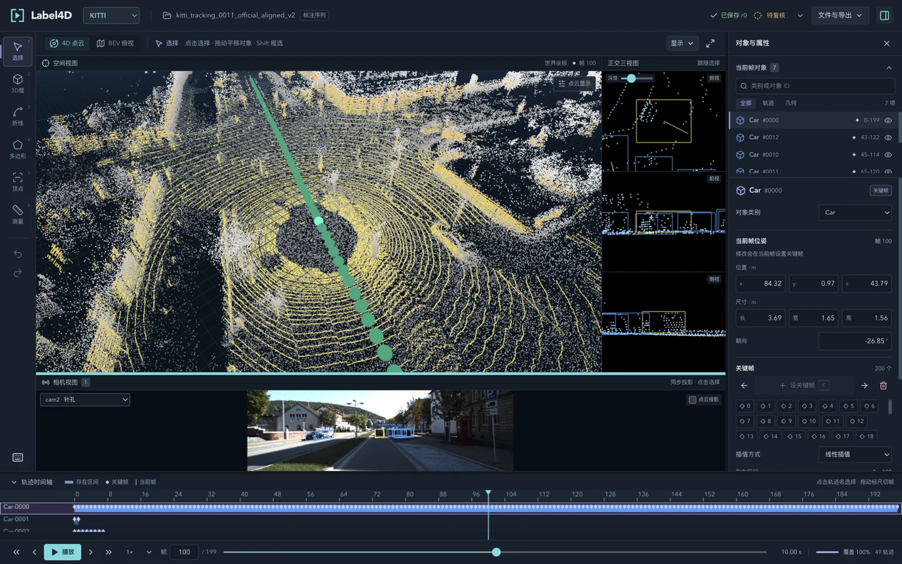
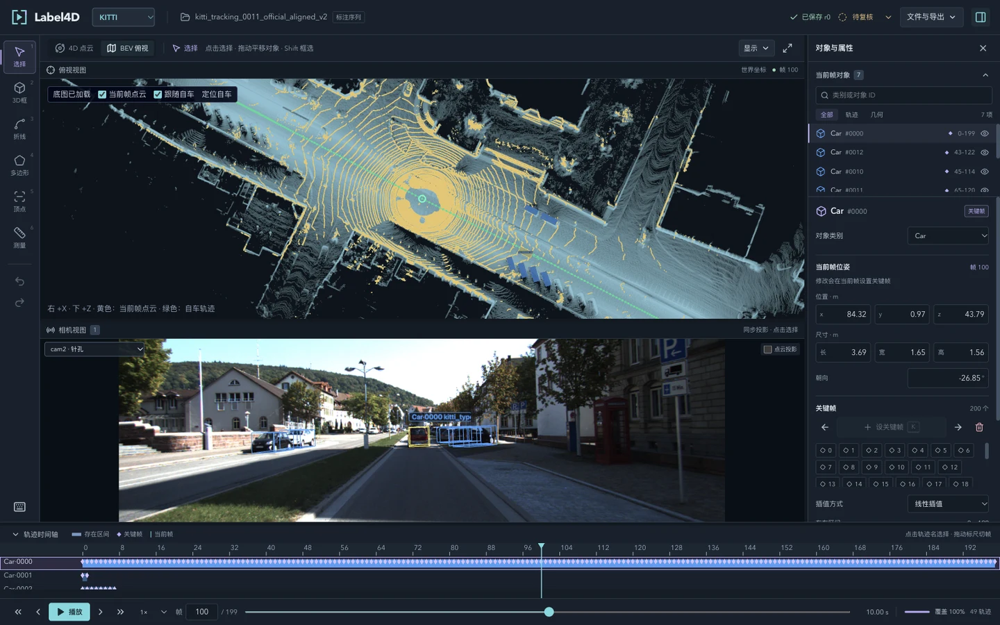
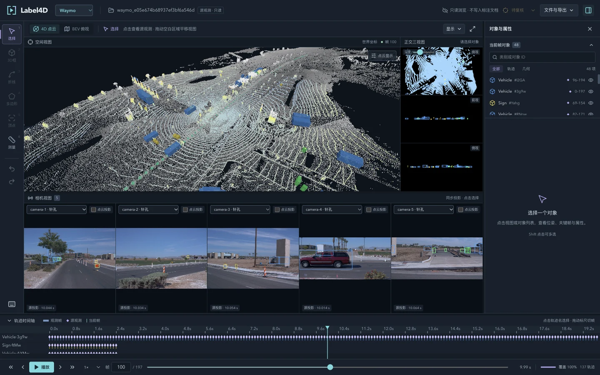

# Label4D

[](LICENSE)
[](https://github.com/label4d/label4d/actions/workflows/ci.yml)

[English](README.md) | **简体中文**

浏览器里的 4D 点云标注工作台：多路相机与点云同步，逐帧标注轨迹与几何。

Label4D 由 React/Three.js 编辑器、TypeScript 标注引擎和 Python 数据工具组成。它在本地跑静态数据集，把标注文档存在浏览器里。



*一个工作区：3D 里的累积激光雷达扫描环与自车轨迹、正交三视图、带投影框的相机视图、对象属性与轨迹时间轴。数据为 KITTI tracking 0011 官方预览。*

## 目前已经能用

- 当前帧点云，以及流式加载的静态 Potree 叠加层。
- BEV 底图，叠加当前帧点云、标注框与自车轨迹。
- 标定后的相机图像、3D 框投影，以及可选的同帧点云投影。
- 轨迹关键帧、插值、对象属性、静态几何、选择与撤销/重做。
- 播放与跳帧，请求帧与呈现帧分离；3D 与 BEV 默认跟随自车。
- 浏览器内 IndexedDB 本地持久化，以及 JSON 快照导入导出。
- 可复用的 KITTI tracking 与 Waymo Perception Python 导入器。
- KITTI 与 Waymo 共用一套 DatasetProvider 资源，编辑、投影与图像加载能力都显式声明。
- Waymo 源数据只读浏览：真实时间戳、五路相机、完整位姿的框，以及官方点像素对应关系。

可编辑文档使用 **v1、右手系、Y 轴向上** 坐标。Waymo 规范化序列走另一套明确只读的浏览契约，不会被转换成仅有 yaw 的 v1 文档。完整位姿编辑与多人协作仍在路线图里，见 [路线图](docs/roadmap.md)。

## 视图



*BEV 俯视：底图、黄色当前帧点云、绿色自车轨迹、标注框。*



*Waymo 源数据只读浏览：五路同步相机与官方投影框、3D 里的完整位姿框、源观测时间轴。*

## 快速开始

需要 Node.js 20 及以上版本和 pnpm 8.15.0。Python 3.11+ 与 [uv](https://docs.astral.sh/uv/) 只在数据工具与 fixture 检查时用到。需要支持 WebGL 的浏览器。

```sh
pnpm install --frozen-lockfile
pnpm dev
```

打开 Vite 打印的地址，通常是 `http://localhost:5173`。首页默认加载 `/kitti-camera/manifest.json`。用 `pnpm fixtures:camera-preview` 准备这份真实数据（需要 Python/uv 与 PotreeConverter），或用 `?manifest=...` 打开其他导入的数据集。真实数据缺失时会明确报错，不会静默回退到合成数据。

开发时 core 包直接引用源码。应用里没有合成演示，也没有模型预标注。`apps/web-ui/tests/fixtures/` 下的小型静态输入只供自动化测试使用，不会被打包。

生产构建：

```sh
pnpm build
pnpm --filter @labelfaster/web-ui preview
```

产物在 `apps/web-ui/dist`。需要用 HTTP 提供服务；`file://` 没有加载与浏览器存储所需的环境。

## 用真实数据

Python 导入器读取同一录制的 KITTI tracking 图像、Velodyne 点云、OXTS、标定与标签：

```sh
pnpm data:import:kitti \
  --input /data/kitti --sequence 0004 \
  --output apps/web-ui/public/datasets/kitti-0004 \
  --url-prefix /datasets/kitti-0004 --skip-potree
```

在运行中的应用打开 `/?manifest=/datasets/kitti-0004/manifest.json`。加 `--skip-potree` 会生成当前帧点云、标注、照片与 BEV，不需要 PotreeConverter；要生成静态 Potree 地图则按[转换器构建说明](third_party/POTREE_BUILD.md)编译后去掉该参数。

从下载 → 预处理 → 校验 → 浏览器走查的完整流程，见[数据复现指南](docs/data-reproduction.md)。

[数据工具指南](tools/README.md)涵盖目录结构、按需下载指定官方帧、完整导入、输出标识与重建；[KITTI 验证指南](docs/real-camera-preview.md)涵盖随仓库提供的 200 帧预览。

顶部数据集选择器可以在准备好的 KITTI 预览与完整 Waymo 序列（`/datasets/waymo-normalized-198/sequence.json`）之间切换。切换会重新加载页面，切回 KITTI 时会恢复已保存的标注。两份数据都必须在本地生成；资源缺失会报加载错误。

导入的 Waymo 数据用 `/?manifest=/datasets/waymo-normalized-20/sequence.json` 打开。播放使用源时间戳，3D/BEV 显示完整位姿的框。相机叠加使用数据自带的 2D 投影框与官方点像素对应关系，不声称做了滚动快门重投影。源数据浏览不会写入 IndexedDB，也不导出 v1 快照。

给导入的规范化序列补静态地图：`pnpm data:potree:normalized --input <dataset-directory>`（需要 PotreeConverter），然后重新加载页面。当前帧点云仍然可用。

Waymo 导入与独立的 SDK 校验，见[数据工具指南](tools/README.md)与[规范化契约](docs/normalized-data.md)。

数据集下载与生成的资源不入库。KITTI 与第三方依赖保留各自的使用与许可条款，归属细节见 [NOTICE](NOTICE)。

## 仓库结构

| 路径 | 职责 |
| --- | --- |
| `apps/web-ui/` | React 应用、视图编排、面板与浏览器测试 |
| `packages/core/` | 标注模型、命令、会话、持久化、流式调度、投影与渲染适配 |
| `tools/py/` | Python/NumPy 导入、几何转换、过滤、BEV、LAS 与校验 |
| `scripts/` | fixture 编排、合成 fixture 生成与工程检查 |
| `fixtures/` | schema、测试元数据与少量标定/参考输入 |
| `third_party/` | PotreeConverter 构建说明与 Apple 补丁 |
| `docs/` | 当前架构、数据契约与操作指南（中文） |

## 检查

```sh
pnpm lint
pnpm test
pnpm test:tools
pnpm build
pnpm --filter @labelfaster/web-ui exec playwright install chromium
pnpm --filter @labelfaster/web-ui exec playwright test --workers=2
```

Playwright 自带测试服务，占用端口 **4173**，需要该端口空闲。真实数据用例在生成资源缺失时跳过；编辑器 fixture 用例通过并不能证明真实数据对齐。Python 工具测试包含一份与真实预览无关的小型生成输入。

同一套检查会在每次 push 与 pull request 时由 GitHub Actions 跑一遍（`.github/workflows/ci.yml`）：lint、单测与构建、Python 工具测试，以及浏览器测试。浏览器 job 里没有生成好的 KITTI 或 Waymo 资源，真实数据用例在那里会像全新检出一样跳过。

标注保存在本地浏览器的配置与来源下。清理浏览器数据或更换来源前请先导出快照备份；生成的数据集与保存的标注文档是两件不同的东西。

## 文档与贡献

- [文档索引](docs/README.md) — 当前指南，含中文技术文档。
- [实现架构](docs/architecture.md) — 已实现的组件与 Mermaid 图。
- [数据格式](docs/data-formats.md) — 坐标、manifest 与快照契约。
- [贡献指南](CONTRIBUTING.zh-CN.md) — 开发与验证流程（英文版见 [CONTRIBUTING.md](CONTRIBUTING.md)）。
- [AGENTS.md](AGENTS.md) — 面向编码代理的仓库约定。

## 许可

Label4D 采用 [MIT 协议](LICENSE)。

```
Copyright (c) 2026 The Label4D Authors
```

[NOTICE](NOTICE)记录本仓库引用的第三方组件（PotreeConverter、npm 与 Python 依赖），以及按 KITTI 数据集条款再分发的参考输入。项目协议只覆盖本仓库的代码：KITTI 与 Waymo 数据保留各自的使用条款，数据集下载与生成的资源不入库。安全漏洞报告方式见 [SECURITY.md](SECURITY.md)。
