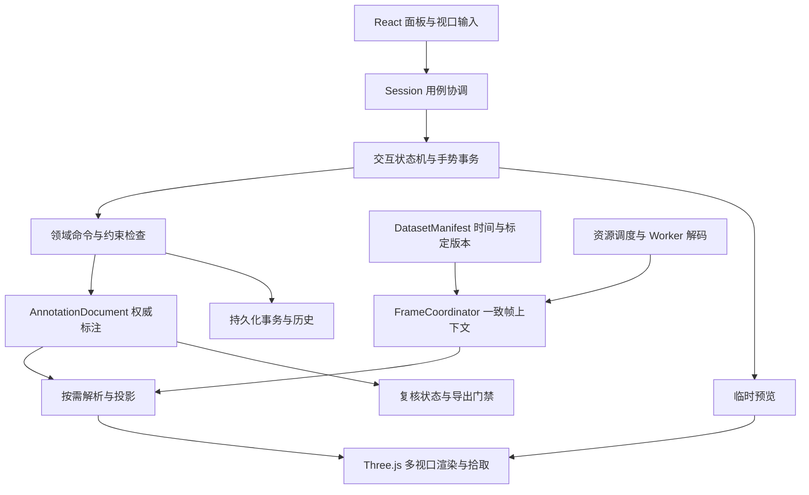

# Labelfaster 文档评审与交互验收建议

评审日期：2026-09-16。范围仅为 `requirements.md`、`docs/architecture.md`、`implementation_plan.md`；未阅读实现代码，未运行产品或测试。本文评价设计约定的充分性，不判定已实现功能的真实质量。文中门槛除原需求已有数值外，均为建议值，需要结合目标硬件和真实数据确认。

后续状态：本文件保留初次评审结论与当时行号。领域模型和资源调度已在 `domain-and-streaming-design.md` 形成设计基线，并同步到三份主文档；这些设计尚未经过实现验收。

## 1. 总体判断

产品方向合理：跨帧轨迹、多视图联动、增量编辑和流式资源管理确实构成此类工具的主干。命令入口、显式工具状态机、按需解析、统一选择集、纯数学投影、渲染增量同步，都值得保留。

目前文档尚不足以证明“商业级”：需求接近功能目录，架构更偏存储和渲染方案，实现计划主要报告模块完成，三者之间缺少可验证的业务契约。最应优先投入的是时间与空间正确性、编辑事务、持久化、复核闭环；不应以继续增加相机模型或插值算法作为主要进展。

建议产品第一阶段定位为：**单人可靠完成一段真实序列的标注、复核、恢复和交付**。团队任务分发、权限、服务端版本、多人协同属于另一个明确范围；若第一阶段就要服务团队生产，这些能力必须进入需求，不能以浏览器本地核心库替代整个平台。

## 2. 需求中应先做出的决定

| 优先级 | 文档现状与依据 | 风险与建议 |
|---|---|---|
| P0 | Sequence 以 fps、帧号、逐帧 pose 描述（需求第 14 行） | 多相机和点云未必同步。增加每资源时间戳、参考时间轴、关联容差、pose 插值和缺帧策略；确定点云是否已去畸变。fps 用于播放，不能替代采样时间。 |
| P0 | 框编辑、关键帧、整体平移均有要求，但修改范围不明（第 22–25、58 行） | 明确编辑当前插值帧是否创建关键帧，以及影响当前帧、相邻插值区间、选定区间还是整条轨迹。界面必须显示修改范围。 |
| P0 | OpLog、快照、崩溃恢复（第 68 行） | 需要定义存储介质、保存完成条件、失败状态、恢复边界和多标签页写入策略。存在 OpLog 不等于已保证持久化。 |
| P0 | 缺高度统一 Z=0（第 54 行） | 把未知变成了看似有效的标注。区分 ready/missing/loading/error/no-data，提供手工高度或显式采用零平面的操作，并记录来源。 |
| P0 | 复核确认、关键帧覆盖率、序列通过/驳回（第 73、84 行） | 插值生成和人工复核是两件事。引入复核区间、问题定位、复核依据版本、修改后失效和交付阻断规则。 |
| P1 | BEV PNG 可标动态目标（第 32 行） | 明确底图是逐帧图像还是静态拼接地图。静态拼接中的车辆可能来自别的时刻，不能直接视为当前帧观测；动态标注须有当前传感器证据。 |
| P1 | 单一存在区间、逐帧属性（第 21–24 行） | 区分物体存在、传感器可见、数据缺失、离开标注范围；定义遮挡时是否持续跟踪、重现后如何关联、是否允许多个存在片段。 |
| P1 | 速度可差分生成又可编辑（第 78 行） | 区分推导速度与人工覆盖，规定优先级和导出语义；不要同时把二者作为互相独立的真值。 |
| P1 | 自车 pose 可以微调（第 77 行） | 明确标注保持世界坐标不变还是重新定位。建议首版原始标定与 pose 只读，校正作为版本化独立能力。 |
| P1 | nuScenes 兼容导出（第 85 行） | 明确是数据集 annotation 格式、检测结果还是跟踪结果；定义坐标、时间、类别/属性映射及不支持几何的处理，用下游读取器验收。 |
| P1 | Three.js 统一绘图（第 9、41 行），架构使用 canvas-texture 标签、Canvas 时间轴（架构第 62、97 行） | 澄清禁令范围：建议空间内容与拾取统一 Three.js，普通表单、弹层、时间轴允许适合的 UI 技术。文字纹理的生成方式另行约定。 |

还应补齐以下具体业务规则：

- 轨迹在首末关键帧外、存在区间内的状态如何解析；零关键帧是否合法；yaw 相差恰为 π 时如何决定方向。
- 拆分点归哪一段、是否插入边界关键帧、合并重叠区间和类别冲突如何处理、稳定业务 ID 如何延续。
- 属性至少区分 track、时间点/时间区间、传感器作用域；遮挡和截断往往依相机而异，不宜只留一个全局布尔值或枚举。
- 物理尺寸是否默认整条 track 固定；若允许变化，是修正测量还是物体形变。类别切换时非法属性如何处理。
- 静态要素首版究竟是几何描绘还是语义地图交付。若是后者，需要拓扑、方向、连通、边界关系；不能用折线/多边形工具的存在代替地图需求。
- PNG BEV 需要像素到地图坐标的变换、轴向、分辨率、原点；相机外参本身不能完整定义任意 BEV 栅格的地理配准。
- 高度图需要编码位深、比例、偏移、垂直基准、no-data 标记。用于视觉显示的低分辨率高度不能悄悄变成精确落点依据；桥上/桥下还需要多层或用户选面策略。
- “交互期间暂停”应具体化：开始修改文档时暂停；悬停、平移视角、滚动面板是否暂停要明确。

## 3. 建议的架构：把正确性边界放在模块之前

不建议全面重写现有分层，也不需要立刻拆成很多发布包。先在现有 monorepo 内确立以下依赖与契约。

### 3.1 四类状态必须分开

1. **DatasetManifest**：原始数据索引、时间戳、坐标约定、标定、pose、资源版本。默认只读。
2. **AnnotationDocument**：稳定对象 ID、稀疏关键帧、静态几何、属性、来源、复核记录；通过领域命令修改。
3. **SessionState**：选择、hover、工具、播放位置、视角、过滤条件；通常不属于标注 undo，但可以另存用户偏好。
4. **DerivedState / ResourceCache**：当前帧解析结果、投影、GPU buffers、解码图像和点云；可以随时丢弃重建。

这可以避免选择变化污染文档版本、缓存内容误入快照、一次切帧生成海量永久对象等问题。复核记录可以审计持久化，但其权限和撤销规则应单独定义。

### 3.2 用 FrameCoordinator 保证“看到的就是正在编辑的”

区分 requestedFrame 与 presentedFrame。拖动时间轴可以发出许多请求，只有满足呈现策略的帧才能成为当前可编辑帧。

每个呈现上下文携带参考时间、各传感器样本时间、dataset/calibration/pose 版本、标注版本与 request epoch。晚到的旧请求可以进缓存，但不能覆盖当前帧。切换帧时投影、拾取和底图必须来自同一个有效上下文。

需要预先声明哪些资源是编辑必需、哪些允许缺失：例如当前点云可为必需，相机 6 可以暂缺但必须显式标记并关闭该视图旧投影的拾取。不能让“帧号 100、点云 99、图像 98”以正常状态出现。离线数据即使已同步，也应由导入校验声明这一事实。

播放和标注采用不同策略：复核播放缺必需资源时暂停等待；快速浏览可明确标示跳帧。需求中的 4x 对 10Hz 数据意味着最高 40 个采样帧/秒，需规定是否承诺逐帧呈现。

### 3.3 一次手势是一笔事务

`begin → preview* → validate → commit / cancel`。

begin 捕获对象 ID、文档版本、已呈现帧和修改范围；pointermove 只更新临时预览；松手校验成功后提交一条逻辑命令；Esc、pointercancel、失焦按明确规则回滚。拖到画布外需要 pointer capture 和释放规则。

手势期间禁止换编辑帧，或在切帧前明确取消该手势；导出只读已提交文档。一次拖拽产生一次 undo，而不是几百条位置修改。其他视图实时显示同一份预览，但不能把它当作已保存状态。

UI 可以处理焦点、输入法、弹层布局和 pointer capture；核心负责编辑语义与约束。“UI 无业务逻辑”不应演变成核心依赖 DOM 的理由。

### 3.4 稀疏领域模型为真值，SoA 用在确实需要的地方

架构第 17 行从“百万级 resolved states”直接推导“必须 ECS”，论据不足：按需解析已经避免了百万永久对象。实际存储量应由关键帧密度、静态顶点数、属性量和历史规模估算。

建议保留稀疏 Track/Geometry 领域模型，维护稳定业务 ID；当前帧解析、投影和渲染使用 SoA/typed arrays。已有列式实现若质量良好可以保留，但不要让槽位和 generation 成为持久化 ID，或让领域命令依赖 GPU buffer 排布。

全局坐标与 Float32 的组合需要限定范围：坐标值约 1,000,000 米时 Float32 间距约 6.25 厘米。建议权威坐标及变换使用 Float64，渲染减去局部原点后转 Float32；若采用局部世界坐标，也必须固定原点和精度契约。

按 start 排序再二分不等于完成高效区间相交查询：前缀中仍可能需要筛 end。数千对象时直接扫描可能已足够；测量后再选择索引。文档中的“重建 <1ms”应视为待验证目标。

### 3.5 命令、历史和持久化分别建模

方法式 `do()/undo()` 可以用于内存执行，但 durable log 应存可序列化的数据记录，明确 command/event schema 版本、事务 ID、基准文档版本、稳定对象 ID、确定的变更与逆变更。

候选导入需要先校验并暂存，再原子提交。重放保存后的候选数据，不能重跑模型服务。undo/redo 也必须有可恢复的记录，否则“撤销后崩溃”可能重新出现已删除修改。

以浏览器本地方案为例，可用 IndexedDB 保存逻辑事务和 revision，快照作为检查点；具体介质应通过容量与故障试验决定。只在持久化事务成功后显示“已保存”；等待期间显示“保存中”，失败显示“未保存/失败”。明确浏览器本地数据的持久性边界，并提供备份或远端同步路径。

快照按操作字节数、恢复耗时和空闲时间综合触发，比固定每 200 次更稳妥。base64 比原始二进制约膨胀三分之一，它是 JSON 传输方案，不是压缩；大体积持久化可采用二进制块，交换格式再提供 JSON。

“撤销无限”改为可实施契约：会话内支持撤销全部已提交编辑，内存历史可分页到磁盘；跨会话保留范围、配额和清理规则另行说明。小编辑和大批量导入分别制定延迟预算。

首版本地单写者即可，但要阻止两个标签页无提示地覆盖同一文档。未来协同需要权限、冲突语义、版本合并和多人 undo；有 OpLog 只是基础条件。

### 3.6 统一预算，分开调度阶段

保留统一资源账本，但分为 fetch、decode、GPU upload 三个队列，设置当前帧保留名额，防止大瓦片阻塞当前相机图像。相机图像虽然在规模表出现，Provider 列表未给出完整职责，应补齐。

资源记录区分压缩字节、解码后 CPU 字节、预计 GPU 字节、在途分配；分别预算。调度器要支持 pin 当前可见资源、取消失效请求、并发去重、失败退避、旧 epoch 拒绝呈现和跨视图共享资源引用计数。

若点云每点仅 xyz + intensity 四个 Float32，即 16 字节，91 帧 × 100 万点已约 1.46 GB（十进制），尚未含压缩源、解析副本、GPU 和多相机。±45 帧应是最大预取范围，不是必须全解码驻留；根据播放速度、方向、带宽和预算动态调整。GPU 主要驻留当前帧与必要邻帧。

Worker 解码和可转移 buffer 应作为流水线契约提前设计，是否启用由剖析决定；不要等 UI 卡顿后才重构所有权。WebGL 的真实显存不可完全精确观测，应维护保守估算、上传峰值余量和上下文丢失恢复。

### 3.7 投影与拾取必须共享同一几何定义

投影接口除了 project，还应有有效域、裁剪、边缘细分和可选反投影能力。鱼眼空间中直线投影通常是曲线，不能仅投 8 个角点再连直线就称为精确投影；跨相机平面、出图、宽视场边界需要明确处理。

等距、等立体角、OpenCV fisheye 不能凭名字混用系数。manifest 必须声明精确公式、系数顺序、内参、图像尺寸、原图/去畸变图状态和适用域。

用于显示的可见片段和用于拾取的几何应一致。凸包可以做候选筛选，不宜默认当作精确命中区域；还需要决定线框点击容差、框选规则、重叠对象的排序与循环选择。真实遮挡不等于投影可见性，不能用一次视锥测试替代。

### 3.8 复核和交付是领域能力

候选对象保留模型版本、来源和置信度，区分候选、接受、驳回。批量导入成功不代表人工已核验。

建议用区间记录复核覆盖，绑定 annotation revision 与 calibration/pose 版本。改变第 10 帧关键帧可能影响两侧插值区间，相关复核必须过期。问题项应包含对象、时间区间、问题类型、备注和处理状态。

交付要求无阻断问题、所需范围已复核、schema 校验通过和目标导出读取成功。标注进度、复核进度、数据完整度分别展示；关键帧数不能替代完成率。

## 4. 如何证明交互真的满足需求

### 4.1 每条核心需求都要有可观察结果

建立追踪表：`需求 ID → 前置数据 → 用户操作 → 文档后置条件 → 界面后置条件 → 恢复/导出结果 → 证据 → 状态`。

状态至少区分设计中、已实现待验证、自动验证通过、真实数据验收通过。实现计划的勾选和“36 个测试”只能是现有声明，不能代替证据。必须同时验证：用户确实能操作到、结果语义正确、重新打开仍正确。

### 4.2 三类数据集

| 数据集 | 目的 | 内容 |
|---|---|---|
| S：可解析合成序列 | 提供独立正确答案 | 少量已知轨迹、相邻关键帧、跨 ±π 朝向、交叠目标、非零世界原点、不同传感器时间戳、缺高度、异常几何、鱼眼边界 |
| R：真实短序列 | 暴露真实导入与操作问题 | 建议 20–60 秒，有遮挡、漏帧、真实标定、真实 BEV 配准和人工核验目标；尽早纳入第一条闭环 |
| L：规模与长时序 | 性能、资源释放、稳定性 | 3000 帧、1000 条总轨迹，另声明峰值同时可见数、关键帧密度、点数/帧、相机数量/分辨率、静态几何规模、瓦片数 |

合成数据的预期结果不能由被测投影/插值代码生成。针孔可用手算控制点，畸变模型可使用约定一致的独立参考实现；往返变换测试本身不能排除正反方向同时写错。

### 4.3 核心验收场景

| ID | 真实操作及故障注入 | 必须证明的结果 |
|---|---|---|
| A01 | 在 BEV 画框，在 3D/相机检查，再选中相机投影 | 同一稳定对象 ID；尺寸、方向、时间位置正确；选择高亮双向同步；没有意外创建副本 |
| A02 | 在第 10、20 帧建关键帧，在第 15 帧移动框 | 第 15 帧按约定新增关键帧；10/20 帧不变；相邻区间按新规则解析；界面显示影响范围 |
| A03 | 连续多次 pointermove 后松手；再拖动并 Esc | 第一段手势只新增一条历史；Esc 后文档和历史均不变；所有视图清除预览 |
| A04 | 播放中开始编辑，同时让旧图像响应晚到 | 编辑冻结在同一已呈现帧；旧响应不覆盖；缺数据视图不显示为正常可编辑状态 |
| A05 | 拖出画布、失焦、切工具、切帧、调整窗口 | 按既定规则提交或取消；不残留工具状态、光标锁定或悬空预览；坐标映射仍正确 |
| A06 | 拆分、合并、裁剪后连续 undo/redo | 区间边界无意外重叠/丢失；ID、属性、关键帧与复核状态符合规则；往返恢复等价文档 |
| A07 | 点选、框选鱼眼边缘和相互重叠的框 | 独立投影参考误差达标；可见曲线与拾取一致；重叠对象可以明确消歧；隐藏对象不误选 |
| A08 | 高度瓦片延迟、404、no-data，再恢复 | 不把未知高度静默写成 0；粗细 LOD 切换不改变已提交几何；用户可知道高度来源 |
| A09 | 批量导入中途制造非法候选或持久化失败 | 按约定全部拒绝，或先过滤并报告后原子提交；不能留下半批数据；成功提交可单步撤销 |
| A10 | 事务提交前后终止页面，特别是 undo 之后 | 重启恢复到最后持久化确认 revision；无半笔事务；已撤销对象不会因重放复活；显示过“已保存”的内容不丢 |
| A11 | 快速拖轴、往返切模式、反向播放、低资源预算 | 当前帧资源有优先级；旧请求不污染；没有必需资源被错误驱逐；内存稳定且恢复后可编辑 |
| A12 | 完成复核，再改影响区间的关键帧或标定版本 | 受影响复核过期；未受影响部分尽量保留；交付门禁阻止错误通过 |
| A13 | 保存重开、自有格式往返、指定 nuScenes 导出 | 语义和 ID 保持；数值误差在约定范围；目标下游读取器接受；不支持内容显式报告 |
| A14 | 真实标注员完成短序列并交给另一位复核者 | 无人指导可完成关键流程；记录用时、误操作、返工、遗留错误与阻断问题 |

属性编辑另需覆盖：track 与当前时间作用域、清除覆盖后的继承、schema 校验、中文输入、输入框中的 Delete/Ctrl+Z 不误触全局删除/撤销。需求写单击改属性，而实现计划写双击，必须统一验收口径。

### 4.4 自动化分层与证据

- **领域层**：例子测试加随机操作序列，验证正尺寸、合法时间区间、稳定 ID、插值边界、事务原子性、undo/redo 等价性、快照与重放等价性。
- **资源集成层**：可控时钟和假网络制造乱序、失败、取消、超预算，验证 epoch、pin、重试、解码结果与释放。
- **浏览器层**：Playwright 等工具走真实 pointer/keyboard 事件，覆盖高风险路径；固定布局和设备像素比，但另测缩放、resize。避免通过 Session 直接创建对象来冒充“用户画框成功”。
- **视觉层**：固定环境做关键帧截图、局部图像差异和投影像素控制点检查；截图是补充，不能单独证明对象 ID、修改范围和持久化。
- **人工任务层**：建议首轮找 3–5 位目标使用者进行形成性测试；这用于发现问题，不是具有统计代表性的效率证明。记录独立完成率、时间和错误，作为下一轮基线。

为 WebGL 增加只读测试观测接口：呈现帧上下文、对象/选择 ID、文档 revision、历史长度、save revision、pending requests、资源预算、当前手势状态。观测接口只能读，不得绕过真实交互来让 E2E 通过。

每次失败保存输入数据版本、随机种子、浏览器/硬件、操作 trace、截图、文档摘要、frame epoch 和保存状态。这会显著降低“偶尔点不动/画错帧”的定位成本。

### 4.5 性能门槛必须能够重复测量

| 指标 | 建议测量口径 |
|---|---|
| 切帧 <100ms | 缓存命中场景，以输入事件到一致帧实际呈现计，建议 p95 <100ms；同时报告 p99。缓存未命中另计，明确 loading 行为。 |
| undo/redo <50ms | 先限定小编辑，测到视图正确呈现；大批量事务另列预算与进度反馈。保存完成延迟单独报告。 |
| 10fps 播放 | 参考 10Hz 时间轴，在声明的就绪窗口内按时间戳统计应呈现/实际呈现帧及停顿，不能只看 rAF FPS。4x 单独验收。 |
| 拖拽反馈 | 新增输入到预览呈现指标，建议 p95 ≤50ms；相机转动与拖拽在资源解码时也测。 |
| 冷启动 <1.5s | 明确硬件、浏览器、数据大小、磁盘/网络与缓存状态；首帧可交互必须含必需传感器和可用拾取，空画布不算。 |
| 资源稳定性 | 固定长时间往返操作，建议至少 30 分钟，观测释放后的稳态、队列长度、上传峰值和 GPU 上下文恢复；总预算含解码和在途资源。 |

数学误差、人工标注误差与视觉误差应分开：例如独立投影参考的像素误差可提出 ≤0.5px 初值，人工标注误差需要由下游用途和类目制定，不能混成一个“精确”要求。

## 5. 调整实现计划

当前计划把真实数据接入放在多数功能勾选之后，把性能放在再之后，风险发现太晚。“manifest 同构”不能证明标定、时间和语义同构。

建议按可交付闭环重排，并以门槛而非模块数量推进：

1. **契约冻结与真实样本**：确定时间、坐标、编辑作用域、属性、复核、保存、导出；准备 S/R 数据集与独立答案。退出条件：同一操作不存在两种合理解释。
2. **最小生产闭环**：真实序列加载 → 画一条轨迹 → 插值帧编辑 → 跨视图核对 → undo → 保存重开 → 导出。优先覆盖 A01–A04、A10、A13。
3. **数据正确性与复核**：补全边界操作、缺失数据、候选事务、复核失效、目标格式验证。不得存在已知阻断级数据错误。
4. **并行于功能演进的规模闸门**：从第 2 步起持续跑 L 的代表性子集，逐步扩大到全规模；调度、解码、渲染均有指标，不在末期集中补救。
5. **交互验收与生产试用**：A01–A14 形成证据，真实标注员完成任务并复核；未通过的流程回到需求或设计调整。
6. **按数据需求扩展**：额外投影模型、样条、pose 校正、复杂地图拓扑、协同编辑分别立项。已有功能无需因排序变化而删除，但后续投入应服从闭环风险。

建议发布门槛：无已知错帧/坐标错误/事务残缺/已保存数据丢失问题；核心用户旅程可完成；R 数据通过人工复核；L 达到声明硬件上的预算；导出被目标读取器接受；所有“已完成”需求均能链接验收证据。

## 6. 建议立即修改三份文档的内容

- `requirements.md`：分离产品目标、业务语义、技术约束、验收契约；加入需求 ID 与首版范围；把“商业级/业界标准”替换为角色、任务、交付质量和恢复保证。
- `docs/architecture.md`：补 FrameCoordinator、手势事务、版本化坐标与标定、持久化协议、复核失效；明确 Float64/Float32 边界、资源三阶段预算和测试观测接口；把未经测量的性能断言改为待验证设计假设。
- `implementation_plan.md`：将功能勾选拆成实现与验收状态，增加真实数据闭环、故障注入、交互旅程和交付证据；真实样本及规模约束前移。

本评审只新增建议文件，未改变上述三份基线文档，避免将尚未确定的产品语义写成已批准要求。
