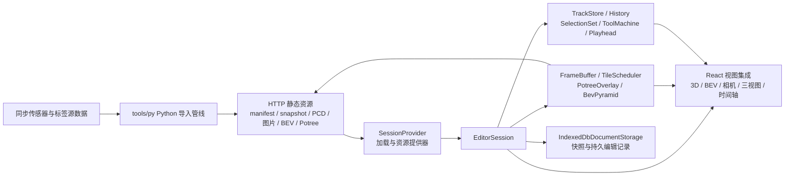
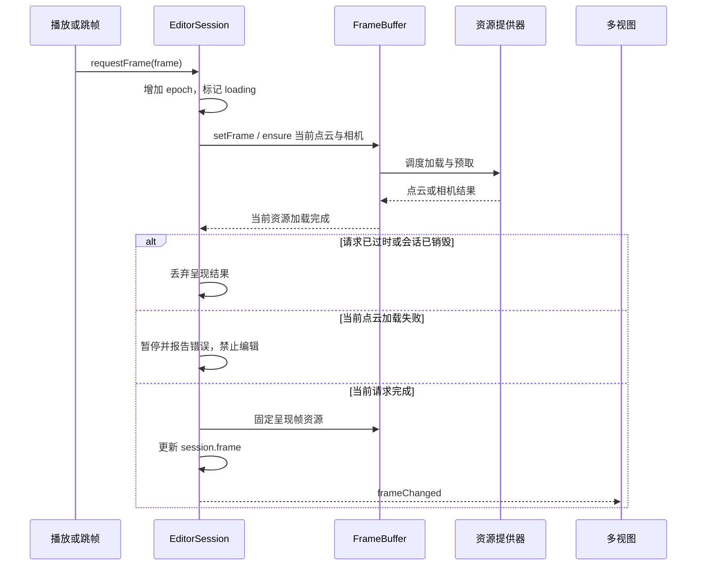
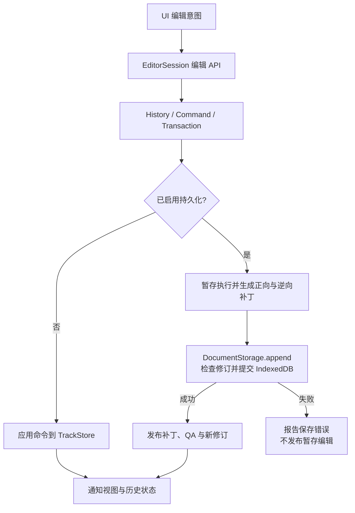

# 实现架构

本文描述当前 v1 实现。未来设计见 [路线图](roadmap.md)；坐标与文件约定见 [数据格式](data-formats.md)。Labelfaster 是静态数据驱动的浏览器单人标注工具，没有必需的应用后端。

## 系统与数据流

首页默认加载 `/kitti-camera/manifest.json`；`?manifest=...` 可指定其他实际数据集，并优先于 demo 参数。仅显式打开 `?demo=1` 才使用合成演示。真实数据缺失或返回非 JSON 时显示加载错误，不自动替换为合成数据。实际资源加载后尝试导入同目录的 `snapshot.json`，再启用本地持久化，恢复该序列已有标注。

| 边界 | 代码与职责 |
| --- | --- |
| 应用 | [apps/web-ui/src](../apps/web-ui/src)：React 面板、快捷键、视口生命周期和会话订阅 |
| 组合根 | [EditorSession](../packages/core/src/session/EditorSession.ts)：编辑、帧呈现、资源、投影、保存状态 |
| 领域模型 | [model](../packages/core/src/model)：稀疏轨迹关键帧、属性、静态几何、选择与校验 |
| 编辑 | [command](../packages/core/src/command)：命令、原子事务、补丁、撤销/重做；OpLog 记录操作 |
| 数学与投影 | [geometry](../packages/core/src/geometry)、[projection](../packages/core/src/projection)：独立于 React/Three.js 的数学与标定变换 |
| 渲染 | [render](../packages/core/src/render)：Three.js 适配器、点云、框、相机图像与自车跟随 |
| 流式资源 | [stream](../packages/core/src/stream)：调度、帧缓冲、Potree 层级与视相关选择 |
| 数据工具 | [tools/py](../tools/py)：Python/NumPy 的导入、坐标转换、动态目标过滤、BEV、LAS/Potree 管线 |

核心包包含渲染适配器；`PotreeSelection` 也依赖 Three.js。不能把整个 core 描述为无渲染依赖的纯领域库。开发时 Vite 直接解析 core 源码；生产构建同时检查库产物和应用类型。

## 帧请求与一致呈现

`requestedFrame` 是播放头请求，`session.frame` 是已经呈现的帧。各视图用后者取点云、照片、框、投影和轨迹；不能用新请求的框覆盖旧点云。

相机加载失败会转为缺失图像结果，不阻塞点云成功的帧呈现；这是当前降级行为，不是所有照片必须成功的同步屏障。epoch 和缓冲代次检查阻止过时结果推进呈现。帧协调位于 `EditorSession`，没有独立的 FrameCoordinator。

`TileScheduler` 共享并发默认 6，管理预算默认 1.5 GiB，提供预留、固定、取消、LRU 和销毁。预算基于受管理资源估算，不等于整个浏览器或 GPU 内存上限。点云默认前取 3 帧、后取 1 帧，相机前取 1 帧。PCD 解码仍在主线程；独立 fetch/decode/upload 阶段和 Worker 尚未实现。

## 编辑与持久化

轨迹关键帧使用 Int32 帧号与 Float32 位置、yaw、尺寸；静态几何顶点也是 Float32。位置/尺寸支持线性插值，yaw 使用最短角度插值，也支持保持模式。存在区间两端均包含。

启用持久化后先提交持久编辑记录再发布状态，避免保存失败但界面已显示成功。恢复会重建文档和撤销/重做历史。[DocumentStorage](../packages/core/src/persistence/DocumentStorage.ts) 使用 Web Locks，缺少时采用带 fencing 的租约，防止同文档并发写入。

QA 是文档整体的 pending/pass/reject 状态；编辑使其失效，撤销恢复相应状态。当前没有按对象、帧或证据维护的独立 ReviewLedger。选择、悬停、导航和工具预览属于会话状态，不是持久标注。

保存按序列 ID 区分。新录制或坐标版本必须换 ID。IndexedDB 数据只属于当前浏览器配置与 origin，不提供云端备份；导出快照用于迁移和备份。

## 多视图与数据边界

- **3D**：当前帧世界点云、静态 Potree、框与轨迹。默认跟随自车，完整位姿运输相机、目标和上方向；手动轨道操作更新相对视角。
- **BEV**：静态过滤点云生成的图片底图，加上当前帧真实点云在 XZ 的投影以及框和自车轨迹。默认跟随中心，手动平移关闭跟随。
- **相机**：真实照片、标定后的框；可选同帧 lidar 投影默认关闭。静态拼接 Potree 不作为同帧相机点云。
- **三视图与时间轴**：正交视图检查当前对象与点云；时间轴用 Canvas。各主视口有独立 Three.js renderer。

Potree 使用内置 UNCOMPRESSED 解码器和 HTTP Range 读取，不加载上游 Potree viewer。选择保留加性祖先样本并按视锥、投影密度和预算细化；默认上限 480,000 点。细节见 [Potree 渲染](potree-rendering.md)。

当前正式数据适配器为 KITTI tracking。模型辅助有适配接口和合成候选生成器，并未接入训练模型。其他数据集、协作后端和性能承诺都需要独立实现与验证。
