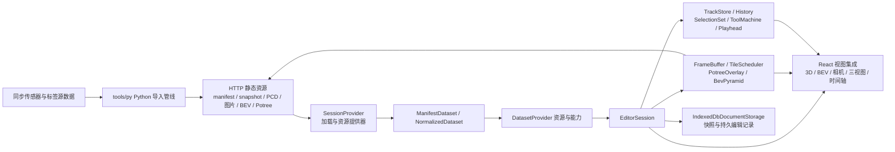
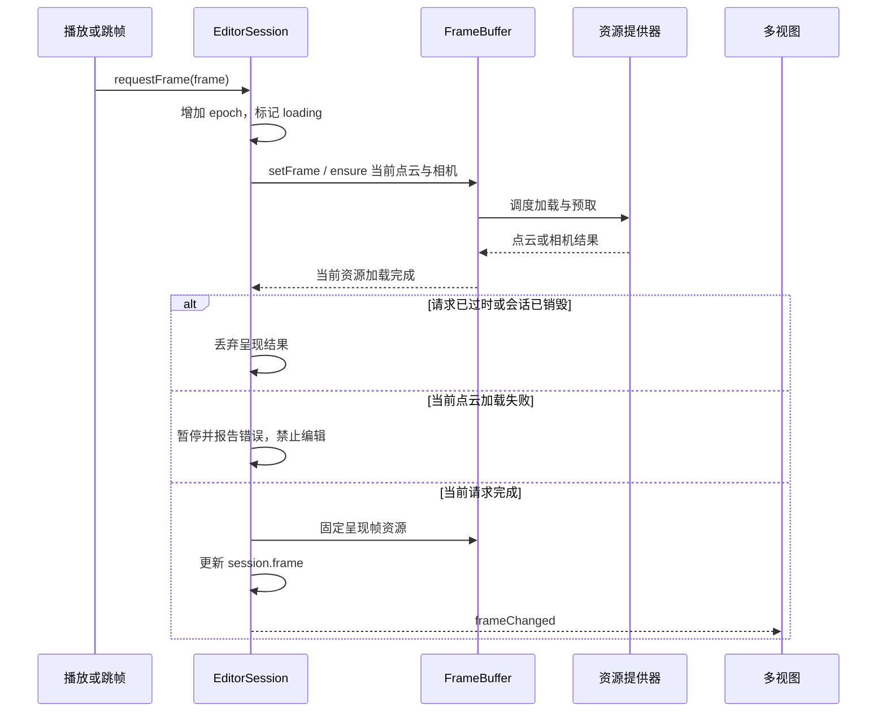
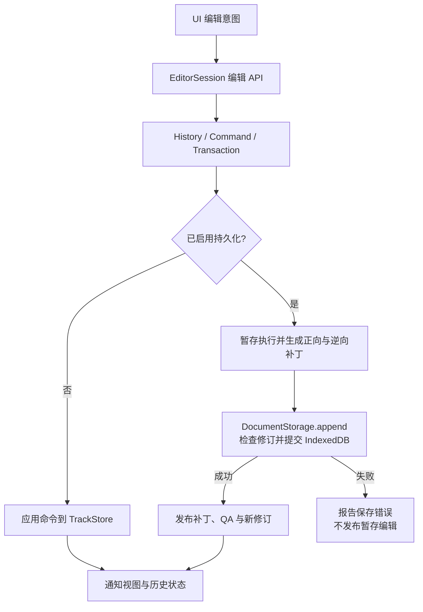
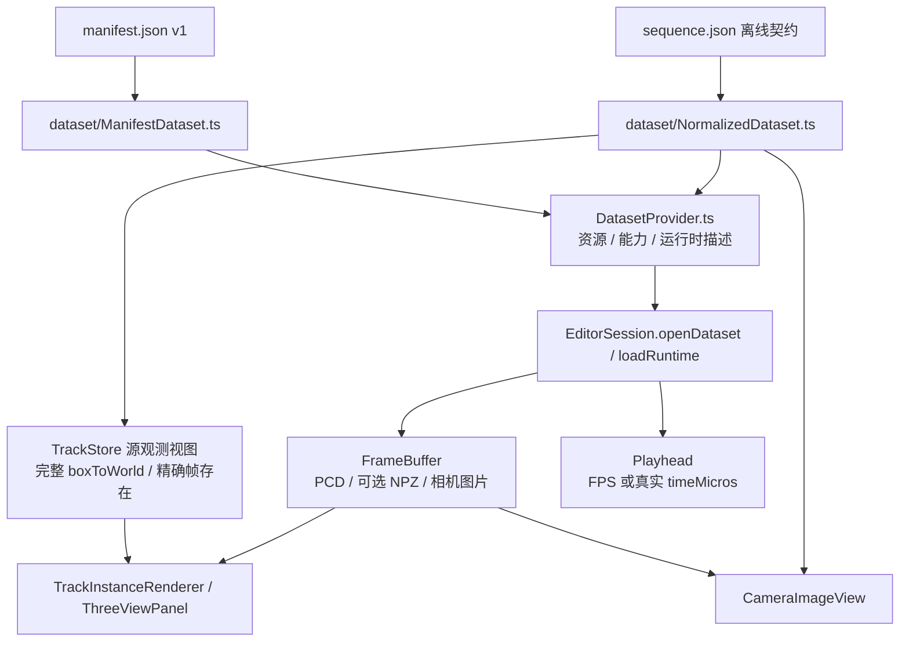

# 实现架构

本文描述当前 v1 编辑器与规范化源观测浏览器。未来设计见 [路线图](roadmap.md)；坐标与文件约定见 [数据格式](data-formats.md)。Labelfaster 是静态数据驱动的浏览器单人标注工具，没有必需的应用后端。

## 系统与数据流

顶部 `Toolbar` 提供 KITTI / Waymo 选择器，切换时更新 `manifest` 查询参数并重新加载页面，沿用启动和序列身份恢复流程；加载/保存进行中、历史提交未完成或保存失败时禁用切换。自定义 manifest 显示为自定义数据集。预置入口需要本地准备对应数据，缺失时报告错误。首页默认加载 `/kitti-camera/manifest.json`；`?manifest=...` 可指定其他实际数据集。产品不再包含合成演示或 demo 参数分支。真实数据缺失或返回非 JSON 时显示加载错误，不自动替换为合成数据。v1 资源加载后尝试导入同目录的 `snapshot.json`，再启用本地持久化，恢复该序列已有标注。两种输入都通过 DatasetProvider 提供资源；规范化 `sequence.json` 不请求 v1 快照或打开 IndexedDB。

| 边界 | 代码与职责 |
| --- | --- |
| 应用 | [apps/web-ui/src](../apps/web-ui/src)：React 面板、快捷键、视口生命周期和会话订阅 |
| 数据适配 | [dataset](../packages/core/src/dataset)：v1 ManifestDataset 与规范化 NormalizedDataset，共用资源和能力接口 |
| 组合根 | [EditorSession](../packages/core/src/session/EditorSession.ts)：编辑、帧呈现、资源、投影、保存状态 |
| 领域模型 | [model](../packages/core/src/model)：稀疏轨迹关键帧、属性、静态几何、选择与校验 |
| 编辑 | [command](../packages/core/src/command)：命令、原子事务、补丁、撤销/重做；OpLog 记录操作 |
| 数学与投影 | [geometry](../packages/core/src/geometry)、[projection](../packages/core/src/projection)：独立于 React/Three.js 的数学与标定变换 |
| 渲染 | [render](../packages/core/src/render)：Three.js 适配器、点云、框、相机图像与自车跟随 |
| 流式资源 | [stream](../packages/core/src/stream)：调度、帧缓冲、Potree 层级与视相关选择 |
| 数据工具 | [tools/py](../tools/py)：Python/NumPy 的导入、坐标转换、动态目标过滤、BEV、LAS/Potree 管线 |

核心包包含渲染适配器；`PotreeSelection` 也依赖 Three.js。不能把整个 core 描述为无渲染依赖的纯领域库。开发时 Vite 直接解析 core 源码；生产构建同时检查库产物和应用类型。

## 帧请求与一致呈现

`requestedFrame` 是播放头请求，`session.frame` 是已经呈现的帧。各视图用后者取点云、照片、框、投影和轨迹；不能用新请求的框覆盖旧点云。

v1 相机加载失败会转为缺失图像结果，不阻塞点云成功的帧呈现。规范化源浏览采用严格屏障：点云、点属性与所有相机均成功才呈现；SHA256、图片尺寸或点序绑定失败会暂停并报告。epoch 和缓冲代次检查阻止过时结果推进呈现。帧协调位于 `EditorSession`，没有独立的 FrameCoordinator。

`TileScheduler` 共享并发默认 6，管理预算默认 1.5 GiB，提供预留、固定、取消、LRU 和销毁。预算基于受管理资源估算，不等于整个浏览器或 GPU 内存上限。点云默认前取 3 帧、后取 1 帧，相机前取 1 帧。PCD 解码仍在主线程；独立 fetch/decode/upload 阶段和 Worker 尚未实现。

## 编辑与持久化

轨迹关键帧使用 Int32 帧号与 Float32 位置、yaw、尺寸；静态几何顶点也是 Float32。位置/尺寸支持线性插值，yaw 使用最短角度插值，也支持保持模式。存在区间两端均包含。

启用持久化后先提交持久编辑记录再发布状态，避免保存失败但界面已显示成功。恢复会重建文档和撤销/重做历史。[DocumentStorage](../packages/core/src/persistence/DocumentStorage.ts) 使用 Web Locks，缺少时采用带 fencing 的租约，防止同文档并发写入。

QA 是文档整体的 pending/pass/reject 状态；编辑使其失效，撤销恢复相应状态。当前没有按对象、帧或证据维护的独立 ReviewLedger。选择、悬停、导航和工具预览属于会话状态，不是持久标注。

保存按序列 ID 区分。新录制或坐标版本必须换 ID。IndexedDB 数据只属于当前浏览器配置与 origin，不提供云端备份；导出快照用于迁移和备份。

## 多视图与数据边界

- **3D**：当前帧世界点云、静态 Potree、框与轨迹。默认跟随自车，完整位姿运输相机、目标和上方向；手动轨道操作更新相对视角。
- **BEV**：静态过滤点云生成的图片底图，加上当前帧真实点云在 XZ 的投影以及框和自车轨迹。默认跟随中心，手动平移关闭跟随。
- **相机**：真实照片、标定后的框；可选同帧 lidar 投影默认关闭。静态拼接 Potree 不作为同帧相机点云。
- **三视图与时间轴**：正交视图检查当前对象与点云；时间轴用 Canvas。各主视口有独立 Three.js renderer。

Potree 使用内置 UNCOMPRESSED 解码器和 HTTP Range 读取，不加载上游 Potree viewer。选择保留加性祖先样本并按视锥、投影密度和预算细化；默认上限 480,000 点。细节见 [Potree 渲染](potree-rendering.md)。

当前浏览器通过 ManifestDataset 接入 KITTI tracking 的 v1 输出，通过 NormalizedDataset 接入 Waymo Perception v2.0.1 的规范化输出，见 [离线契约与模块图](normalized-data.md)。Waymo 已通过只读 DatasetProvider 接入浏览器；完整姿态编辑、撤销和新版本持久化仍待实现。核心保留模型辅助适配接口，UI 中的模拟预标注和合成候选生成器已移除，尚未接入训练模型。其他数据集、协作后端和性能承诺都需要独立实现与验证。

多数据源需要的时间、传感器和共享 Python 管线演进见 [接入设计与阶段状态](multi-dataset-design.md)。

## 统一数据提供与源观测浏览

[DatasetProvider](../packages/core/src/dataset/DatasetProvider.ts) 是资源与观测提供接口；[NormalizedDataset](../packages/core/src/dataset/NormalizedDataset.ts) 负责契约、相对 URL、完整姿态和 Waymo 标签/源投影组件的映射。视图不包含按数据集名称分支。v1 由 [ManifestDataset](../packages/core/src/dataset/ManifestDataset.ts) 校验并提供资源；两种输入都通过统一 openDataset / loadRuntime 生命周期接入 EditorSession，不再在会话中分别解析 PCD 或加载相机图片。内部 `browser-observations/1` 是展示描述，不是可编辑文档的序列化格式。

接口统一 `cloud`、`image(cameraId)`、`egoPoses`、`cameraPose`、采样时间和可选源观测。Provider 负责 URL、解码、校验和迟到图片释放；FrameBuffer 负责有界缓存和呈现帧固定。`capabilities.editing` 决定文档编辑权限，`projection` 区分标定计算与源引用，`imageFailure` 决定照片是否为呈现屏障的必需资源。视图消费 session 的能力与已呈现资源，不判断数据集名称。

KITTI 保留 v1 ID、URL 模板、FPS 时钟、标定投影和既有照片失败容忍策略；相机世界位姿由逐帧自车位姿乘相机外参得到。快照导入、命令、撤销、IndexedDB 恢复仍在文档层。Waymo 使用真实微秒时间和每张照片自己的位姿，要求当前帧所有照片与点云成功加载，保持只读源观测和官方像素引用。统一 Provider 不意味着统一源数据语义或文档格式。

初始化按最多 6 个并发请求读取帧 JSON，丢弃不参与展示的源字段，构造自车轨迹和实际观测索引；上限为 10,000 帧及 128 MiB JSON 字符内存估算。大型序列仍需独立可流式索引，不能把这些边界称为生产规模保证。大资源由 FrameBuffer 有界预取；只解压 NPZ 中的 `camera_projection.npy`，与 PCD 点数和 SHA256 绑定。PCD 与 NPZ 解码仍在主线程。

3D、BEV、三视图和射线选框使用完整 `boxToWorld`；时间轴按真实时间显示实际观测，不填补缺帧。源观测的辅助位置/yaw 列只用于属性与时间轴展示，源状态保留完整 Float64 数值，禁止将辅助列导出为 v1。编辑工具、快照/nuScenes 导出、QA 和持久化在源浏览模式禁用，Session API 与 store 同时拒绝写入。

相机使用每张照片自己的 `cameraToWorld` 与采样时间，默认绘制源 `projected_lidar_box` 的 2D 矩形，点云开关绘制官方像素引用；不绘制由静态模型近似的 3D 框。未关联当前 3D 观测的 2D 框不绘制，没有该组件时不补造矩形。滚动快门计算投影、独立 2D 标注和运动目标重投影尚未实现。

### 规范化序列的可选静态层

`tools/py/build_normalized_potree.py` 从已经校验的逐帧世界 PCD 与完整姿态观测复用 `pipeline/geometry.py` 框过滤、`export_world_las.py` 和 PotreeConverter，生成静态层后更新离线索引。`NormalizedDataset.ts` 校验可选描述和 metadata 哈希，映射到运行时 `potree.url`；`EditorSession`、`PotreeOverlay` 与 `ThreeDView` 复用已有分块调度、GPU 预算和释放流程。逐帧点云及官方相机像素绑定继续独立使用，不从聚合层推导。
