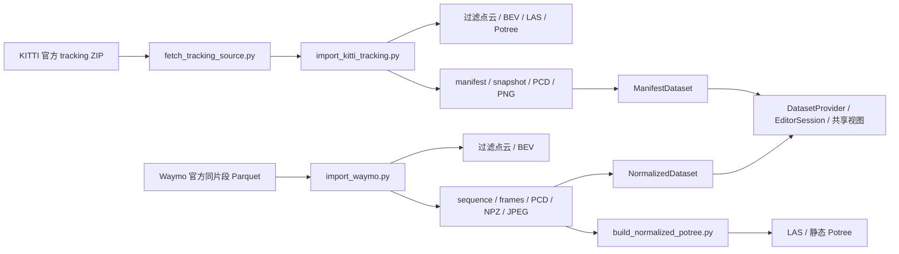

# 数据下载、预处理与复现指南

本文面向第一次克隆仓库的使用者：准备依赖 → 下载同源数据 → Python 预处理 → 校验 → 浏览器展示。所有仓库命令从仓库根目录执行。示例覆盖顶部切换器的 KITTI tracking 0011 前 200 帧和 Waymo Perception v2.0.1 的一个完整 validation 片段，也给出小样本和新序列的入口。

原始照片、雷达和标签来自官方数据集；代码负责转换、过滤和生成派生资源。产品没有合成演示数据。测试中的小型合成 fixture 仅验证软件行为，不能替代真实数据的对齐检查。

## 1. 先认识四类数据

| 类别 | 内容 | 是否入 Git |
| --- | --- | --- |
| 官方源数据 | KITTI PNG/BIN/OXTS/标定/标签；Waymo 同片段 Parquet | 否 |
| 浏览器输入 | 世界坐标 PCD、照片、索引、框观测、NPZ、BEV、Potree | 否 |
| 可复用实现 | `tools/py/`、测试、schema、锁文件、小型参考输入 | 是 |
| 用户标注 | KITTI 在 IndexedDB 中保存的编辑文档；导出的快照 | 浏览器本地保存，需自行备份 |

浏览器输入与用户标注是不同产物。重新生成 `snapshot.json` 不会替换浏览器已保存的同 ID 文档。不要通过清空浏览器存储掩盖不同录制或坐标版本复用了同一 ID 的问题。



## 2. 环境与目录

需要 Node.js 20+、pnpm **8.15.0**、Python 3.11+ 和 [uv](https://docs.astral.sh/uv/getting-started/installation/)。静态 Potree 另需 PotreeConverter。Waymo 下载示例使用 [Google Cloud CLI](https://cloud.google.com/sdk/docs/install)，它不是导入器的依赖。

```sh
# 已有 Corepack 时；若 Node 安装未提供 Corepack，先安装 Corepack
corepack enable
corepack prepare pnpm@8.15.0 --activate
pnpm --version
pnpm install --frozen-lockfile

# 基础工具：NumPy / Pillow
uv sync --project tools/py --locked
# Waymo：另加 PyArrow / JSON Schema；正常导入不需要 TensorFlow
uv sync --project tools/py --locked --extra waymo
```

依赖版本以 `pnpm-lock.yaml` 和 `tools/py/uv.lock` 为准。不要直接向系统 Python 安装未固定版本的库来代替项目环境。下文 `pnpm data:*` 脚本内部使用 `uv run --project tools/py`；需要严格禁止锁文件更新时，可在当前 shell 设置 `export UV_LOCKED=1`。

建议布局：

```text
仓库/
  fixtures/kitti-tracking-source/       默认 KITTI 下载缓存（已忽略）
  apps/web-ui/public/kitti-camera/      默认 KITTI 200 帧浏览输入（已忽略）
  apps/web-ui/public/datasets/
    waymo-v2.0.1-source/validation/     Waymo 下载文件（已忽略）
    waymo-normalized-20/               小样本浏览输入
    waymo-normalized-198/              顶部 Waymo 入口
```

源文件也可以放在仓库外；将命令中的输入路径替换即可。源目录与输出目录必须分离。`public/` 下的文件由 Vite 按站点根路径提供，输出目录与 URL 必须对应。

### PotreeConverter

从 [构建说明](../third_party/POTREE_BUILD.md) 完成安装和编译。macOS 使用文档中的 Apple 补丁；Linux 遵循上游说明，不能把 macOS 的验证当作 Linux 保证。

```sh
# 编译后检查二进制存在且可执行
test -x third_party/PotreeConverter/build/PotreeConverter
# 记录本次转换器源码版本；第三方 checkout 不入库
git -C third_party/PotreeConverter rev-parse HEAD
```

工具默认使用上述二进制位置；其他位置可设置 `LABEL4D_POTREE_CONVERTER`（旧名 `LABELFASTER_POTREE_CONVERTER` 仍会读取）或传 `--potree-converter`。正式输出使用 **UNCOMPRESSED** 编码，浏览器不支持其他编码。构建指南现固定本地真实样本使用的上游 commit `a70ef212198b0e5ae1d071713a0c8cbda8fcc9a7`；第三方源码和二进制不入库，复现实验仍应记录 commit、补丁和编译环境。

## 3. KITTI：下载并复现默认 200 帧

### 3.1 官方来源与下载方式

使用 [KITTI tracking 官方页面](https://www.cvlibs.net/datasets/kitti/eval_tracking.php) 的 training 数据。所需五个包为：

- `data_tracking_image_2.zip`：左彩色相机 image_02。
- `data_tracking_velodyne.zip`：每帧雷达 BIN。
- `data_tracking_oxts.zip`：自车定位与姿态。
- `data_tracking_calib.zip`：标定。
- `data_tracking_label_2.zip`：tracking 标签。

[下载器](../tools/py/fetch_tracking_source.py) 使用代码中的官方 `https://s3.eu-central-1.amazonaws.com/avg-kitti/` 地址。图片和雷达通过 HTTP Range 读取 ZIP 目录和选中帧所在的连续字节区间，不下载整个大 ZIP；小型 OXTS、标定、标签 ZIP 完整下载后取目标序列。连续区间可能包括额外字节，下载量不是所选文件大小的精确总和。

```sh
pnpm data:fetch:kitti \
  --sequence 0011 --frames 200 \
  --output fixtures/kitti-tracking-source
```

输出为工具支持的紧凑缓存布局：

```text
fixtures/kitti-tracking-source/
  source.json
  images/000000.png ... 000199.png
  velodyne/000000.bin ... 000199.bin
  oxts/0011.txt
  calib/0011.txt
  labels/0011.txt
  images.range / velodyne.range         ZIP 区间缓存
```

下载时验证解压文件的 ZIP CRC；`source.json` 记录序列身份。缓存不能跨序列复用，0011 的缓存不能改参数用作 0004。相同参数再次运行会跳过已存在的文件；此存在性检查不重新验证缓存 CRC，文件损坏时应使用新的缓存目录重新下载。中断后可重试相同参数，仍需最终导入与校验成功。帧数超过官方序列长度会报错。

也可在官方页面按当时要求完成账号/条款流程后下载完整 ZIP，解压为 `training/image_02/0011`、`training/velodyne/0011`、`training/oxts/0011.txt`、`training/calib/0011.txt`、`training/label_02/0011.txt`。两个源布局均由正式导入器支持；浏览器访问条款和脚本可访问的下载地址是两件事，访问失败时应核对官方入口，不使用不明来源文件替代。

### 3.2 精确的默认入口命令

```sh
pnpm data:import:kitti \
  --input fixtures/kitti-tracking-source \
  --sequence 0011 --frames 200 \
  --output apps/web-ui/public/kitti-camera \
  --url-prefix /kitti-camera \
  --id kitti_tracking_0011_official_aligned_v2 \
  --work-dir fixtures/kitti-tracking-source/static-preview
```

首次生成时输出应为空。不传 `--skip-potree`，生成当前帧点云、静态地图和所有浏览资源。没有转换器时可加 `--skip-potree` 先查看逐帧点云；此时没有静态 Potree，开关禁用是预期行为。

一键入口：

```sh
pnpm fixtures:camera-preview
```

[一键脚本](../scripts/fixtures/prepare-camera-preview.mjs) 等价于上述下载和导入，并对默认生成目录显式传入 **`--overwrite`**。它会重建本地生成资源，不清除 IndexedDB。首次运行可直接使用；已有数据时先确认这是允许重建的默认预览。通用导入命令默认拒绝覆盖非空目录，不要习惯性添加覆盖选项。

### 3.3 预处理实际做了什么

1. 检查同序列的逐帧照片、BIN、OXTS、标定和标签配对；照片尺寸从源读取。
2. OXTS 角度按弧度处理，将雷达经 `velo → imu → world` 变换，再换成右手 Y-up。世界点以 Float32 XYZI 写入 `pcd/{frame}.pcd`。
3. 照片按源字节复制；标定保留 rectification 与投影基线，生成 cam2 配置。
4. 标签由底面中心变为几何中心，尺寸转为 `[length,height,width]`，生成 yaw 框、轨迹和 `snapshot.json`。v1 框无法表达完整 roll/pitch。
5. 每帧排除已接入类别的人工标签框内点，默认向外增加 0.2 米。过滤点云写到 work-dir，原始逐帧 PCD 保留全部有效点。
6. 从过滤点云生成 BEV 密度图；同一批过滤点通过 LAS（毫米定点）进入 PotreeConverter，形成静态八叉树。

KITTI 当前类别映射为 Car → Car，Van/Truck/Tram → Truck，Pedestrian/Person_sitting → Pedestrian，Cyclist → Cyclist；DontCare 和未接入类别不生成轨迹，也不参与框过滤。

“静态”指上述过滤策略，不能保证完全去除无标签的运动物体；被标签覆盖的静止物体也可能被移除。BEV 底图是一张派生图片，浏览器另叠加当前帧真实点云与框。

### 3.4 输出与独立重建

```text
kitti-camera/
  manifest.json                 v1 资源、位姿、标定、BEV、可选 Potree
  snapshot.json                 导入时的标签种子，不是浏览器最新编辑
  alignment-report.json         源照片/BIN SHA256、点数、过滤策略、BEV 计数
  pcd/0.pcd ... 199.pcd          全部逐帧世界点云
  images/0.png ... 199.png       官方同帧照片
  bev/map.png                   过滤点云聚合的密度底图
  potree/metadata.json
  potree/hierarchy.bin
  potree/octree.bin
```

使用 `--work-dir` 时，中间过滤 PCD 和 `world.las` 留在该目录；否则使用临时目录，完成后释放。保留目录必须属于当前导入，不能混入另一片段或额外帧。

```sh
# 已有默认预览和它的过滤 PCD 时，重新计算 KITTI BEV
pnpm data:bev \
  --input fixtures/kitti-tracking-source/static-preview/pcd \
  --output apps/web-ui/public/kitti-camera --mpp 0.15

# 单独导出过滤世界点云为 LAS，输出父目录必须已存在
pnpm data:export:las \
  --input fixtures/kitti-tracking-source/static-preview \
  --output fixtures/kitti-tracking-source/static-preview/world-rebuilt.las
```

`data:bev` 当前是 v1 重建入口，读取 `manifest.json` 和 `alignment-report.json`，不能直接传 Waymo 的 sequence 目录。不要用输出目录中的未过滤 `pcd/` 重建静态底图。`data:export:las --input` 接收包含 `pcd/` 子目录的目录。

### 3.5 导入其他 KITTI 序列

```sh
pnpm data:fetch:kitti --sequence 0004 --frames 100 \
  --output apps/web-ui/public/datasets/kitti-0004-source
pnpm data:import:kitti \
  --input apps/web-ui/public/datasets/kitti-0004-source \
  --sequence 0004 --frames 100 \
  --output apps/web-ui/public/datasets/kitti-0004 \
  --url-prefix /datasets/kitti-0004
```

打开 `/?manifest=/datasets/kitti-0004/manifest.json`。通用导入器不传 `--frames` 时使用源中全部可用帧；紧凑缓存只含已下载的帧。不同录制或不兼容坐标版本必须有新 ID；不同帧子集也应使用不同输出目录/ID，避免文档恢复冲突。

## 4. Waymo：下载一个片段并预处理

### 4.1 账号与格式

从 [Waymo 官方下载入口](https://waymo.com/open/download/) 登录，并按官方要求完成数据条款与访问授权。选择 **Perception v2.0.1、Parquet、validation 或 training**，不要使用 Motion、TFRecord 或仅裁剪对象 assets 代替当前导入器的输入。test split 不属于当前导入器支持范围。

浏览器登录不会自动使终端获得访问权限。本仓库没有 Waymo 自动登录/下载器；下面是取得授权后使用官方 Google Cloud CLI 的复现方法。也可以通过官方 Cloud Storage 浏览界面下载，之后必须保留下述目录与文件名。

### 4.2 仅下载同一 segment 的组件

示例片段为 `10203656353524179475_7625_000_7645_000`。v2.0.1 bucket 为 `waymo_open_dataset_v_2_0_1`；下载前以官方入口显示的版本与路径核对。其他 release 不能只改 bucket 名后认为导入器兼容。

```sh
# 使用已被授予 Waymo 访问权限的 Google 账号；不要把凭据写进仓库
gcloud auth login

task_waymo_segment=10203656353524179475_7625_000_7645_000
task_waymo_split=validation
task_waymo_root=apps/web-ui/public/datasets/waymo-v2.0.1-source
task_waymo_bucket=gs://waymo_open_dataset_v_2_0_1

# 先确认版本、账号权限和该片段存在
gcloud storage ls \
  "$task_waymo_bucket/$task_waymo_split/vehicle_pose/$task_waymo_segment.parquet"

# 八个必需组件 + 五个推荐组件，约一个片段的下载量
for task_component in vehicle_pose camera_calibration lidar_calibration \
  camera_image lidar lidar_pose lidar_box lidar_camera_projection \
  camera_box camera_to_lidar_box_association lidar_camera_synced_box \
  projected_lidar_box stats
do
  mkdir -p "$task_waymo_root/$task_waymo_split/$task_component"
  gcloud storage cp --no-clobber \
    "$task_waymo_bucket/$task_waymo_split/$task_component/$task_waymo_segment.parquet" \
    "$task_waymo_root/$task_waymo_split/$task_component/$task_waymo_segment.parquet" || break
done
```

循环在下载失败时停止，必须确认全部所需文件完成后再导入；不能把部分成功看成下载完成。`--no-clobber` 跳过已有文件，不能证明其内容完整，损坏文件应在新的源目录重新取得。Google Cloud CLI 不随本仓库安装，其账号/权限和文件传输步骤需在自己的环境执行。

| 组件 | 当前用途 |
| --- | --- |
| vehicle_pose、camera_calibration、lidar_calibration | 自车与传感器位姿、标定，必需 |
| camera_image | 五相机原始 JPEG 与每图位姿、曝光信息，必需 |
| lidar、lidar_pose | 五雷达、双回波 range image 与 TOP 逐像素位姿，必需 |
| lidar_box、lidar_camera_projection | 3D 观测与点到相机参考像素，必需 |
| projected_lidar_box | 推荐；浏览器相机框使用其源 2D 矩形，没有它就不显示这些框 |
| camera_box、camera_to_lidar_box_association、lidar_camera_synced_box、stats | 可选源组件，离线保留；当前没有对应编辑闭环 |

目录为 `源根/validation/组件/segment.parquet`。`--input` 传**源根**，不是 `validation/`，也不是某一个 Parquet 文件。不要重命名为短文件名、混用 release/split/segment，或仅取一个雷达来冒充完整片段。八个必需组件缺少任何一个都会拒绝导入。源根若已有 `source.json`，其 version、split、segmentId 必须匹配；不要把另一片段的元数据复制过来。

### 4.3 先导入 20 帧

```sh
pnpm data:import:waymo \
  --input apps/web-ui/public/datasets/waymo-v2.0.1-source \
  --split validation \
  --segment 10203656353524179475_7625_000_7645_000 \
  --frames 20 \
  --output apps/web-ui/public/datasets/waymo-normalized-20
pnpm data:validate:normalized apps/web-ui/public/datasets/waymo-normalized-20
```

输出目录必须**尚不存在**，即使空目录也拒绝；工具会创建输出父目录。导入和校验在临时目录完成，成功后才发布。`--frames 20` 减少导入输出和计算量，不能减小已下载的整个片段 Parquet。

先打开 `/?manifest=/datasets/waymo-normalized-20/sequence.json` 检查五相机、逐帧点云、BEV、源框和播放。此阶段尚未生成 Potree，其开关禁用正常。此小样本不是顶部 Waymo 预置入口。

### 4.4 导入完整片段，再创建 Potree

```sh
pnpm data:import:waymo \
  --input apps/web-ui/public/datasets/waymo-v2.0.1-source \
  --split validation \
  --segment 10203656353524179475_7625_000_7645_000 \
  --output apps/web-ui/public/datasets/waymo-normalized-198
pnpm data:validate:normalized apps/web-ui/public/datasets/waymo-normalized-198

pnpm data:potree:normalized \
  --input apps/web-ui/public/datasets/waymo-normalized-198
pnpm data:validate:normalized apps/web-ui/public/datasets/waymo-normalized-198
```

该例完整片段有 198 帧；目录名不控制帧数。不传 `--frames` 才导入全部参考帧。20 帧与完整片段用不同输出目录，各自的序列 ID 从源文件哈希、版本、片段、帧数等信息派生；有无可选源组件也会影响身份，需下载同一组文件才能复现同一 ID。

Potree 构建从已校验的逐帧世界 PCD 重新排除全部完整姿态观测框内点（默认 padding 0.2 米），复用 LAS 和转换器。无需重读原始 Parquet。所有点被过滤掉的帧计为零并跳过其 LAS 输入；全序列无剩余点时拒绝生成。已有 Potree 拒绝覆盖，应在新的完整导入目录重建。先生成和校验三个文件，再发布目录，最后更新 `sequence.json`；失败不会启用缺失资源。

### 4.5 Waymo 预处理与输出

- 按精确参考帧键组合样本，保留真实微秒时间、各相机采样位姿和源字段。重复、乱序、缺帧和传感器集合不匹配报错。
- NumPy 解码五雷达双回波 range image；TOP 用源逐像素位姿补偿，其余雷达用参考帧位姿。换基为 Y-up，并平移到首帧自车局部世界，保持坡度与 roll/pitch。
- PCD 保存合并世界 XYZI；NPZ 与 PCD 点序、点数和 SHA256 绑定，保留雷达、回波、range pixel 和官方相机像素索引。不能独立排序 NPZ。
- JPEG 不重编码；3D 框保留完整 `boxToWorld`。源观测不补缺失帧，不转换为 yaw-only 编辑文档。
- 默认排除全部观测框内及外扩 0.2 米的点生成 BEV；默认分辨率 0.25 米/像素。过滤中间 PCD 随临时目录释放。

```text
waymo-normalized-198/
  sequence.json                 规范化契约、来源/哈希、传感器、时间、BEV、可选 Potree
  frames/0.json ... 197.json     每帧自车/样本位姿、3D 观测、源组件
  pcd/0.pcd ... 197.pcd          五雷达双回波世界点云
  attributes/0.npz ... 197.npz   与 PCD 逐点绑定的属性
  images/camera-1/0.jpg ...      五相机原始 JPEG
  bev/map.png
  import-report.json            点数、过滤计数、耗时和能力限制
  potree/metadata.json           后续静态构建添加
  potree/hierarchy.bin
  potree/octree.bin
  potree/build-report.json       每帧输入/保留/排除点数与过滤策略
  reference-report.json         执行独立官方参考校验后才存在
```

正常导入不生成 `manifest.json` 或 `snapshot.json`。Waymo 当前为只读浏览，不写 IndexedDB，也不能把源观测导出为 v1 标注。相机点云使用官方参考像素，框使用源 2D 投影矩形；没有实现滚动快门计算重投影。

## 5. 校验：分别证明什么

### 5.1 工具回归与资源绑定

```sh
pnpm test:tools
pnpm test:tools:waymo
pnpm data:validate:normalized apps/web-ui/public/datasets/waymo-normalized-198
```

基础工具测试可跳过缺少 Waymo 可选依赖的测试；要覆盖这些回归应执行 `test:tools:waymo`。规范化校验检查 schema、身份、时间、刚体变换、照片、PCD/NPZ 属性绑定，以及可选 Potree 三文件的哈希与 metadata 点数/编码。它不是原始数据和输出之间的独立数值对照。

KITTI 的 `alignment-report.json` 给出每帧源照片/BIN 哈希、静态过滤点数及 BEV 输入点数；同源真实参考检查见 [KITTI 验证说明](real-camera-preview.md)。`pnpm verify:preflight` 只检查历史 fixture/schema/checksum，不能用作当前真实导入完整验收。

### 5.2 Waymo 官方 SDK 独立参考

此步骤使用 TensorFlow 和 Python 3.11，仅作为数值核验。先完成授权下载与正式导入；校验器还需要网络获取固定 commit 的官方 SDK 数值源文件，并验证代码 SHA256。

```sh
# 小样本覆盖：首/中/末帧；想覆盖全部 20 帧需显式列出所有帧号
uv run --project tools/py --python 3.11 --extra waymo-reference \
  python tools/py/validate_waymo_reference.py \
  --input apps/web-ui/public/datasets/waymo-v2.0.1-source \
  --output apps/web-ui/public/datasets/waymo-normalized-20 \
  --frames 0 10 19

# 完整片段抽样：不是 198 帧全部 SDK 数值验收
uv run --project tools/py --python 3.11 --extra waymo-reference \
  python tools/py/validate_waymo_reference.py \
  --input apps/web-ui/public/datasets/waymo-v2.0.1-source \
  --output apps/web-ui/public/datasets/waymo-normalized-198 \
  --frames 0 99 197
```

输出 `reference-report.json`，对照双回波 XYZ、框八角点和原始点到相机像素的索引对应。源码 commit 和哈希固定在 [校验器](../tools/py/validate_waymo_reference.py) 中；结果仅覆盖所选帧，不证明滚动快门重投影、编辑正确性或生产规模性能。

### 5.3 浏览器与真实渲染

```sh
pnpm dev
```

使用 Vite 打印的实际地址。默认通常为 `http://localhost:5173`，不要假设某位开发者的 4175 服务已经存在。顶部 KITTI 对应 `/kitti-camera/manifest.json`，Waymo 对应 `/datasets/waymo-normalized-198/sequence.json`。其他输出通过 `?manifest=...` 打开，顶部显示自定义数据集。

核对首帧、中间帧、末帧，确认照片、点云、框、自车与轨迹同步；播放时 3D/BEV 默认跟随自车。点云显示菜单中的状态必须出现“Potree 已显示 … 点”，不能只看复选框。服务须支持 `octree.bin` 的 Range 请求。

```sh
# 将地址替换为自己正在使用的服务
curl -I -H 'Range: bytes=0-255' \
  http://localhost:5173/datasets/waymo-normalized-198/potree/octree.bin
```

期望 `206 Partial Content` 和对应 `Content-Range`。返回 HTML 通常是路径错误或 Vite 的页面回退，不是点云资源。

```sh
pnpm --filter @label4d/web-ui exec playwright install chromium
pnpm --filter @label4d/web-ui exec playwright test \
  real-camera.spec.ts real-bev.spec.ts normalized-source.spec.ts \
  dataset-switch.spec.ts --workers=2
```

测试自行启动 4173 服务，端口应空闲。缺少真实资产会跳过相关测试；应记录实际跳过项。测试会在自己的浏览器上下文验证 KITTI 编辑、切换 Waymo、返回后恢复及撤销，不需要清空日常浏览器标注。

## 6. 参数、规模与复现记录

| 参数 | KITTI | Waymo |
| --- | --- | --- |
| `--frames` | 不传使用输入中全部帧 | 不传使用全部参考帧；20 帧与完整片段分别导入 |
| `--box-padding` | 默认 0.2 米 | 导入与 Potree 工具均默认 0.2 米；两次应使用相同策略 |
| BEV 分辨率 | `--bev-mpp 0.15` | `--bev-mpp 0.25` |
| 输出保护 | 非空目录拒绝；显式 `--overwrite` 可重建 | 输出目录必须不存在；Potree 已存在拒绝重建 |
| 静态中间文件 | `--work-dir` 可保留 PCD/LAS | 导入中间 PCD 临时释放；Potree 构建另生成临时 PCD/LAS |

BEV 单图最大 4096×4096，超限明确报错。需要更大范围时选择更粗的 `--bev-mpp`，不要静默裁切。改变 Waymo BEV 参数需重新导入至新目录；当前没有为规范化序列单独重建 BEV 的正式 CLI。改变独立 Potree padding 不会自动更新原有 BEV。

2026-10-08 的实际样本作为对照，不能视为通用下载量或耗时保证：

| 样本 | 原始世界点数 | 静态保留点数 | 其他对照 |
| --- | --- | --- | --- |
| KITTI 0011 前 200 帧 | 23,587,775 | 22,726,101 | 49 条导入轨迹 |
| Waymo 示例前 20 帧 | 2,536,159 | 以该次报告为准 | 504 个框观测，100 张照片 |
| Waymo 示例完整 198 帧 | 26,080,281 | 23,761,961 | 7,271 个框观测，990 张照片 |

Waymo 的 13 个源组件共 544,218,943 字节；完整浏览输出连静态 Potree 约 1.3 GiB。Potree 构建临时需要过滤 PCD、LAS 和最终八叉树同时存在，因此磁盘空间要留出中间副本余量。源数据、20 帧输出、完整输出和构建缓存会叠加占用空间。

报告字段注意：当前 Waymo `import-report.json.dynamicPoints` 指**全部逐帧有效点数**，不是被过滤的动态点数；KITTI 同名字段也记录全部逐帧输入点数。实际排除点数用输入减 `staticPoints`，或读 Potree `build-report.json.excludedPoints`。不要从字段名推断分类。

完整 Waymo 样本的序列 ID 为 `waymo_e05e674b68937ef3bf6a546d`。该 ID 只用于相同源码适配器和相同 13 个源文件的对照，不应硬编码到新导入；由工具自行派生。

每次复现至少记录：仓库 commit、锁文件、Python/Node/pnpm 版本、数据 release/split/sequence 或 segment、源文件哈希、完整命令（帧数/ID/padding/mpp）、转换器 commit/补丁、三个生成/校验报告，以及浏览器检查覆盖。报告有时间戳、耗时，snapshot 也含创建时间；即使数据几何一致，JSON 也不保证逐字节相同，转换器产物同样未承诺跨版本/平台的字节确定性。

## 7. 常见失败与处理

| 现象 | 检查与处理 |
| --- | --- |
| KITTI Range 下载报错 | 网络与官方地址、代理是否剥离 Range；下载器要求 206，不会退化为整包下载；可按官方页面手动取完整包 |
| KITTI 缓存身份冲突 | 用新缓存目录；不要改 source.json 冒充另一序列 |
| Waymo 401/403 | 浏览器许可是否完成、CLI 是否登录同一获授权账号；不把凭据放进仓库 |
| Waymo 404 / No URLs matched | bucket/release、split、组件、segment 名称；官方页面确认同片段存在 |
| 缺组件、缺帧或传感器不匹配 | 补齐同 release/split/segment 文件；不能用另一录制补齐 |
| 输出已存在 | 通用 KITTI 用新目录；只有确认重建生成数据才覆盖。Waymo 用新的不存在目录 |
| Potree 开关禁用 | 检查 manifest/sequence 是否已有 Potree 描述；KITTI 未跳过转换器，Waymo 是否运行单独构建命令 |
| Potree 一直加载 / 0 点 | metadata/hierarchy/octree 路径、UNCOMPRESSED、Range 206、网络/浏览器错误；勾选不等于渲染成功 |
| 照片不显示、返回 HTML | manifest 路径与输出目录、相机文件是否存在；Waymo 必须相机与点云都成功才呈现新帧 |
| BEV 尺寸超限 | 增大 `--bev-mpp` 后重新导入；KITTI 可用保留的过滤 PCD 单独重建 |
| 返回 KITTI 后看见旧编辑 | 同 ID 的持久文档正常恢复；导入种子不覆盖已有文档；有意新录制需新 ID |
| SDK 校验无法安装 TensorFlow | 使用示例中的 `--python 3.11` 和 `--extra waymo-reference`；它不影响正常 NumPy 导入 |

更多数学边界见 [数据格式](data-formats.md)、[规范化契约](normalized-data.md)；工具入口索引见 [tools/README](../tools/README.md)。
