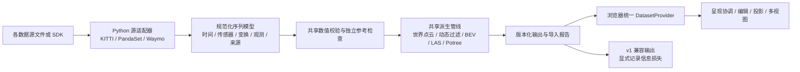

# 多数据源接入设计与阶段状态

浏览器演进部分仍是接入方案。阶段 1、2 已实现独立的规范化离线契约、Waymo Python 适配器和参考校验器，见 [规范化离线数据](normalized-data.md)；当前浏览器仍只读取 v1，KITTI 管线保持兼容。现有行为见 [实现架构](architecture.md) 和 [v1 数据格式](data-formats.md)。

## 数据源与当前实施顺序

当前先用一个 Waymo **Perception** validation 片段验证离线适配，再实现浏览器读取和编辑闭环；之后接入具有 cuboid 标注的 PandaSet 场景，检查六相机和双雷达差异。小样本先验证，再扩展到完整片段，不先下载整个数据集。

2026-10-07 查询到的下载信息：

| 数据源 | 已确认的信息 | 接入时的下载策略 |
| --- | --- | --- |
| PandaSet | [官方](https://pandaset.org/)列出 100+ 个 8 秒场景、10 Hz、六相机和两类雷达；[非官方镜像](https://huggingface.co/datasets/georghess/pandaset)列出 103 场景、单个 pandaset.zip 归档 44.5 GB | 优先官方源；如使用镜像，核对版本、文件清单与来源，通过已验证的 ZIP Range 方式只选一个完整场景。44.5 GB 是该镜像的压缩归档，不是官方归档或解压空间承诺 |
| Waymo Perception | [官方](https://waymo.com/open/about/)列出 2,030 个 20 秒片段、10 Hz、五雷达和五相机。实际下载量取决于版本、组件和 split，完整传感器数据按 TB 量级规划，当前全量精确字节数未核实 | 选择一个有 3D 标签的 training/validation 片段；优先组件化格式，取所需相机、雷达、标定、位姿与标签。不要下载 Motion 或仅对象裁剪 assets 来代替完整感知片段 |

PandaSet 也是几十 GB 的全量数据，而不是轻量内置样本。该镜像只有单个 ZIP，普通下载会传完整 44.5 GB；选择一个场景导入并不自动减少网络下载。按场景下载需要官方分包、本地已有数据，或验证服务器 Range 支持后按 ZIP 中央目录提取成员；目录探测已确认该镜像按预期返回 HTTP 206 和精确 Content-Range，但正式下载器仍需实现成员提取、CRC、断点恢复、缓存身份与版本固定；不能假设现有 KITTI 下载器已经支持 PandaSet。已通过 HTTP 206 Range 读取约 9.09 MB ZIP 中央目录元数据：归档精确长度 44,520,528,731 字节，103 个场景，单场景压缩成员合计范围 357,266,306–473,762,546 字节；001 为 436,219,963 字节，002 为 413,160,502 字节。这里只求和 ZIP 成员压缩大小，不含请求/ZIP 局部头开销，未下载照片或点云，也尚未验证成员 CRC 或完整场景。约 0.36–0.47 GB 是该镜像的实测目录结果，不是所有发布版本的保证。原始文件、图片副本、世界 PCD、过滤 PCD、LAS、Potree 和 BEV 会叠加占用磁盘；小规模试验可先预留 5–10 GB 工作空间，再按实际报告修正，避免在正式导入前承诺精确占用。

Waymo 下载入口需要账号和许可。导入器仅消费已获得的本地文件，不替用户登录或接受条款。数据许可与 SDK 代码许可分开核对。SDK/镜像资料可能随版本改变，因此导入记录必须固定实际数据版本与文件哈希。

## 为什么只加 Python 脚本不够

Python 适配器适合处理源格式和 SDK 差异；**共享数据契约与浏览器运行时决定能表达哪些语义**。新增一个复制 KITTI 管线的脚本，可以展示部分新数据，却不能完整支持多样性。

| 维度 | 当前实现与代码证据 | 所需能力 |
| --- | --- | --- |
| 时间轴 | [manifest](../packages/core/src/io/manifest.ts)仅有 fps/frameCount；[Playhead](../packages/core/src/playback/Playhead.ts)按固定帧时长播放 | 明确编辑参考时间、各传感器原始采样时间、匹配策略和时间误差；按实际时间播放/插值 |
| 多雷达 | manifest 只有一个 pointCloud；[PCD](../packages/core/src/io/pcd.ts)返回 xyz/intensity/rgb | 独立 sensor/sample 身份和可选逐点时间、来源、回波字段；合并只是派生展示方式 |
| 相机投影 | 固定 cameraToEgo；[CameraProjector](../packages/core/src/projection/projection.ts)用同一 frame 的 ego pose | 每张图像的时间、标定引用和采样时刻 cameraToWorld；同步误差不为零时不能假设同帧同位姿 |
| 框与轨迹 | [TrackStore 类型](../packages/core/src/model/types.ts)只有 yaw，存在区间单段且按帧索引插值 | 区分人工观测、插值、未标注、不可见和不存在；保留完整源姿态、原始 ID 与标签体系 |
| 数据管线 | [KITTI importer](../tools/py/import_kitti_tracking.py)同时读源数据、处理 KITTI 标定、转换、过滤并写 manifest | 拆成源适配器、规范化模型、共享处理、版本化输出，不让每个数据集各维护一套数值处理 |
| 来源与降级 | 当前有专用 alignment-report，但没有通用能力/损失契约 | 固定来源、配置和工具版本，列出未支持字段、重采样与精度损失，不宣称无损兼容 |

## 推荐的模块边界

目标 Python 组织方式：`adapters/` 负责各 SDK、文件布局和源语义，`model/` 定义规范化结构，`pipeline/` 负责共享变换与派生处理，`writers/` 负责运行时版本输出与报告，CLI 仅组合这些模块。当前已抽取 KITTI 的 PCD、坐标基与 BEV 共享部分并加入 Waymo；规范化 writer 仍在 CLI 中，浏览器版本输出与 PandaSet 尚未实现。

适配器提供序列索引、传感器定义、逐样本读取、位姿、标定与标注观测。按样本迭代，避免默认把整个数据集或全部传感器一次加载到内存。浏览器只读取统一输出；SDK、pickle、TFRecord/Parquet 解码依赖留在离线层。PandaSet 的 pandas 与 Waymo 的 SDK/解码依赖应按适配器可选安装；若 Python/平台依赖冲突，使用独立适配器环境，仍输出相同规范化契约。

PCD、LAS 和 Potree 是派生资源，不承担全部原始数据语义。逐点来源、时间、分割/实例标签可放在有 schema 的伴随数组中；必须绑定点数、顺序和哈希。过滤、排序、重采样时维护索引映射，不能把语义标签按错误点序重新附上。

## 规范化契约必须表达什么

- **身份与来源**：dataset、release、split、scene、原始 sample/object ID、文件哈希、适配器版本、导入配置。文档 ID 根据源身份与不兼容变换配置派生，防止复用浏览器旧标注。
- **时间**：序列相对整数微秒与原始时间原点；采样区间、图像曝光时间信息（源数据提供时）、逐点时间偏移和同步质量。避免把绝对纳秒直接塞进 JS Number。
- **传感器**：任意数量的相机/雷达，稳定 ID，独立采样、缺失标记、标定与位姿引用。编辑帧是参考时刻，不是所有传感器文件编号相同的证明。
- **空间**：显式单位、轴、变换方向和矩阵/四元数顺序；保留 Float64 变换和世界原点，转成局部世界后才写 Float32 点。当前展示继续使用右手 Y-up，不因为接新源而顺带改变既有坐标约定。
- **标注观测**：原始类别及映射、中心/尺寸/姿态、置信度、属性、观测时间和人工/模型/插值来源。关键帧插值应按真实时间权重，避免将稀疏人工标注伪装成逐帧人工框。
- **能力与损失**：3D 框、点级分割、2D 框、地图、姿态、逐点时间等按 capabilities 声明；未支持的源数据保留并报告，UI 只启用实际支持的能力。

最近邻匹配需要明确最大时间误差和是否允许重复使用样本，超出阈值显示缺失。相机投影使用对应图像的采样位姿；这只补偿自车运动，不会自动修正运动目标、滚动快门或扫描畸变。需要保留源数据的已补偿状态，禁止重复 deskew。

## PandaSet 必须专项处理的语义

[官方 SDK](https://github.com/scaleapi/pandaset-devkit)说明点云已经是世界坐标，包含 `x,y,z,i,t,d`；`t` 是逐点时间，`d` 区分两类雷达。应做轴/原点规范化，不再套用 KITTI 的 velo → imu → world 变换。

每路相机和雷达都有自己的 poses/timestamps。首次接入保留各图像的 cameraToWorld，核对坐标方向，并实测各路时间差，不能只比较文件编号。传感器 pose 也不自动等于车辆后轴 ego pose：能由已知外参还原时才标为自车，否则显式声明跟随的参考传感器和原点。

Cuboid 的 `dimensions.x` 是宽、`dimensions.y` 是长、`dimensions.z` 是高；引擎尺寸是长/高/宽。朝向要通过源长度轴变换后求引擎 yaw，用官方 SDK 的框角点验证，不能复用 KITTI 的 rotation_y 公式。`uuid`、`cuboids.sensor_id`、`cuboids.sibling_id` 的关联也要保留，避免把不同雷达对同一目标的描述当成重复目标，或错误合并。

首期支持两路点云身份、六相机、3D cuboid 与属性；先用机械雷达建立参考验证，再验证双雷达选择/合并。点级分割保留源索引与标签，可作为后续编辑能力，不在首期声称已经支持。

## 运行时需要同步演进

已实现的源浏览 `DatasetProvider` 按参考时间解析资源，并返回样本引用、位姿、标定与质量标记。`EditorSession` 保持现有 requested/presented 与 epoch 机制，加载的是明确匹配的样本集合；资源键使用序列、传感器、sample 和处理版本，不能只靠 frame。

需要扩展时间表、传感器样本索引和相机逐样本位姿，并在 Playhead、插值、投影、帧缓冲与导出中贯彻。不能只向 JSON 添加浏览器会忽略的字段就声明已支持。

当前 v1 继续读取；无损表达需要新契约时使用明确的新版本及迁移入口。这里不复用历史 Z-up v2 fixture 作为实现规范。新增时间/样本位姿等运行时语义应使用明确的新契约版本和 schema 标识，不能只塞入 v1 的未知字段。可另提供有限的 v1 预览输出，但只接受满足其同步、固定外参、yaw 框假设的输入；若输出不能保证投影正确就拒绝生成。损失报告不能代替消费者实现，也不能掩盖错误投影。

完整 roll/pitch 框、点级编辑与 2D 独立标注需要额外领域/UI 工作。适配器可保留这些源数据，但仅保留并不等于应用已支持编辑；不兼容的数据必须报告或拒绝，不能静默压成 yaw。

## 实施顺序与验收

当前阶段 1、2：已抽取共享 PCD writer、坐标基与 BEV rasterizer，Waymo reader/decoder 位于 `adapters/`，离线交换契约与校验器已实现。KITTI 尚未整体迁移到规范化模型；DatasetProvider、真实时间与完整姿态只读浏览已实现；独立 Writer、完整姿态文档与编辑闭环仍待实现。验证范围与可重复命令见 [离线契约](normalized-data.md) 与 [工具指南](../tools/README.md)。下面保留各能力的验收要求，PandaSet 在 Waymo 浏览器闭环之后实施。

1. **共享管线**：已抽取 PCD、坐标基和 BEV；后续继续分离 KITTI reader/writer，保持既有投影、框朝向、点数、来源与浏览器恢复回归。
2. **时间和传感器契约**：离线契约已实现相对时间、逐样本相机位姿、能力声明和严格缺失拒绝；最近邻匹配、missing 样本仍待实现；独立只读浏览描述已接入。
3. **Waymo 小样本与完整片段**：固定格式/版本，独立官方 SDK 验证 range image、双回波、运动补偿与框八角点；先 20 帧，再完整片段。真实验证范围见 [离线契约](normalized-data.md)。
4. **浏览器与真实编辑**：DatasetProvider、真实时间与完整姿态源浏览已实现，浏览器检查播放/跳帧、相机切换和多视图资源。完整姿态修改/撤销/保存重载、按源时间导出仍待实现；当前只读模式禁用 v1 文档写入。
5. **PandaSet 检验通用性**：选一个场景，先 10–20 帧，参考 SDK 验证框角点、投影、六相机、双雷达筛选、标签关联及世界坐标；通过后导入完整 80 帧。

只有同源真实参考、独立数值检查和浏览器实际绘制都通过，才能声明接入完成。当前 KITTI 和新数据源应分别给出验证证据；内部变换自洽、演示截图或 schema 校验不能替代真实对齐。
