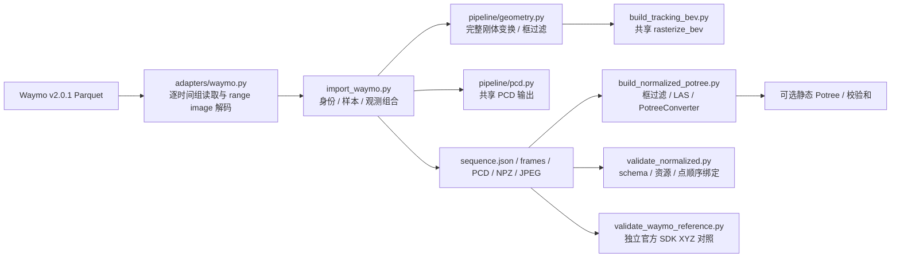

# 规范化离线数据契约：revision 1

阶段 1、2 已实现的产物是 `sequence.json`，schema 标识为 **`labelfaster.normalized-sequence/1`**。它是离线交换契约，**不是浏览器的 v1 manifest，也不是历史 Z-up v2 fixture**。浏览器现在通过独立 DatasetProvider 只读读取它，内部描述标识为 `labelfaster.browser-observations/1`。导入器不生成有损的 v1 manifest/snapshot。真实时间播放和完整姿态展示已接入；完整姿态编辑及滚动快门计算投影属于后续阶段。

序列索引的机器规范见 [JSON Schema](../fixtures/schemas/normalized-sequence.v1.schema.json)，资源与跨文件约束由 [validate_normalized.py](../tools/py/validate_normalized.py) 检查。revision 1 实现完整可用样本的严格 profile：缺少必要传感器样本则拒绝导入；异步最近邻匹配、missing 样本及标定随时间变化仍需扩展契约，不能把默认行为视为已支持。

下载授权、单片段组件下载、导入与静态 Potree 的完整命令见 [数据复现指南](data-reproduction.md)。

## 文件和模块



```text
sequence.json                 序列身份、源文件校验和、传感器、时间索引、BEV
frames/0.json                 自车位姿、每传感器样本、完整框观测与源字段
pcd/0.pcd                     合并世界点云，binary Float32 XYZI
attributes/0.npz              与 PCD 点序绑定的属性，禁止单独排序
images/camera-1/0.jpg          原始 JPEG 字节，未经重编码
bev/map.png                   排除观测框内点后的聚合栅格
import-report.json            点数、耗时、相机位姿时间偏差及能力限制
reference-report.json         独立参考检查成功后生成
```

所有资源路径相对 `sequence.json` 所在目录，必须在导入目录内，禁止绝对路径、`..`、反斜杠及逃逸的符号链接。浏览器将这些路径相对数据集根 URL 解析；不能沿用当前 v1 的站点根相对模板规则。

## 身份、时间和传感器

- `id` 从 release、split、segment、源文件 SHA256、适配器版本、契约版本、帧子集与回波选择派生。同一源的 20 帧试验与全片段使用不同身份。坐标转换变化必须升级适配器版本；输出目录名不决定身份。
- `time.sourceOriginMicros` 是十进制字符串，保留绝对时间原点。各帧 `timeMicros` 为相对整数微秒，从零严格递增，不从 10 Hz 推算。整数不能超出 JavaScript 安全范围。
- Waymo 的 `frame_timestamp_micros` 是关联键。`matchingPolicy: exact-frame-key` 表示文件配对策略，**不表示相机曝光和雷达扫描同时发生**。
- `camera-{sourceId}` / `lidar-{sourceId}` 为传感器稳定 ID；每个样本有独立 `sampleId`。五个雷达按 sourceId 排序，每个雷达先 return 1 再 return 2，各自保留点区间和空回波。
- 相机保留 `referenceTimeMicros`、`poseTimeMicros`、`cameraToWorld`，以及原始曝光、readout、速度和位姿字段。绝对浮点秒原值保存在 `sourceFields`，相对微秒时间由原值舍入得到。
- 不根据雷达 azimuth 推测逐点时间。TOP 已按源逐像素位姿补偿，其他雷达按源参考帧位姿处理，分别声明 `motionCompensation`。

## 空间和框观测

采用右手 Y-up、米、Float64 列主序刚体矩阵。源世界只平移到首帧自车原点，并换基 `(x,y,z) -> (x,z,-y)`，不抹平坡度或车辆 roll/pitch；`sourceWorldToLocal` 保留逆向还原所需信息。点在局部世界计算后才写 Float32，避免大世界坐标精度损失。

`egoToWorld` 将 Y-up 自车坐标转换到局部世界。相机采用光学 X 右、Y 下、Z 前；源 Waymo 相机 X 前、Y 左、Z 上必须单独换基。每张照片使用自己的 `cameraToWorld`，不能替换成对应参考帧自车位姿乘固定外参。

`boxObservations` 是每帧实际提供的标签，不生成跨缺失帧的插值或连续存在区间。尺寸为 `[length,height,width]`，局部 X/Y/Z 分别为长/高/宽。`boxToWorld` 保留完整旋转和平移，包括源车体 roll/pitch。源 objectId、类别枚举、速度、难度和点数等字段保留在观测中；不自行将 Waymo 的 VEHICLE 拆成 Car/Truck。

相机同步框、2D 框、关联关系、投影框和 stats（如果提供）保存在各帧 `sourceComponents` 中，保持原始字段与身份。浏览器当前仅读取 `projected_lidar_box` 作为与当前 3D 观测关联的源 2D 矩形；其他原始组件仍只离线保留，尚不能编辑。

## 点序与属性

`pointCloud` 同时记录 PCD 与 NPZ 的 SHA256、点数和属性 schema。点顺序为 `(sensorId, returnId, range-row, range-column)`；每个 lidar 样本的 `pointOffset/pointCount` 覆盖这一合并数组，不重新配对最近邻点。

| NPZ 数组 | 类型与形状 | 语义 |
| --- | --- | --- |
| `sensor_id`, `return_id` | UInt8 `[N]` | 原雷达与回波身份 |
| `range_row`, `range_column` | Int32 `[N]` | 有效 range pixel 的源索引 |
| `range`, `elongation`, `nlz` | Float32 `[N]` | 原始距离、回波伸长、no-label-zone 字段 |
| `camera_projection` | Int32 `[N,6]` | 官方提供的两组 `(cameraId,u,v)`，cameraId=0 表示该组无投影 |

`camera_projection` 是**原始点的参考像素**，可用于后续独立核对；它不是本工具计算出的相机投影，也不能用于投影编辑后的框。当前不实现滚动快门模型与运动目标重投影。

## 兼容策略和验收边界

当前 v1 的 `fps`、固定相机外参和 yaw-only 轨迹不足以表达本契约。浏览器使用独立 `browser-observations/1` 描述贯穿加载与呈现，并通过源观测视图保留完整姿态；完整姿态编辑、撤销、持久化和导出需要后续独立文档契约。仅给 v1 JSON 添加未知字段不能声明兼容。KITTI v1 输入与已有标注继续保留。

阶段 2 检查范围：源身份、时间组、文件 SHA256、照片解码/尺寸、刚体变换、点序绑定、过滤/BEV 点数，以及独立官方 SDK 的 XYZ 对照。参考检查只对显式选择的帧执行，报告列出实际覆盖。官方 SDK 与 NumPy 使用相同源数据，但数值实现独立；不能据此声称计算相机投影、浏览器绘制、框编辑或全数据集性能已经验收。

## 本次真实片段检查

2026-10-08，用 Perception v2.0.1 validation 的 `10203656353524179475_7625_000_7645_000` 执行。源文件为 13 个同片段组件，总计 544,218,943 字节；数据与详细报告留在被 Git 忽略的导入目录中。

| 范围 | 前 20 帧 | 完整 198 帧 |
| --- | --- | --- |
| 点数（五雷达、双回波） | 2,536,159 | 26,080,281 |
| 3D 框观测 | 504 | 7,271 |
| 结构、资源、点序校验 | 全部 20 帧 | 全部 198 帧 |
| 官方 SDK 参考覆盖 | 全部 20 帧，200 个雷达/回波样本，504 个框 | 帧 0、99、197，30 个雷达/回波样本，122 个框 |
| 最大 XYZ 分量误差 | 0.000003815 米 | 0.000015259 米 |
| 最大框角点误差 | 小于 0.000000001 米 | 小于 0.000000001 米 |

完整片段相机 pose 时间相对参考键的偏差为 21,306–81,697 微秒，直接证明“同帧键”不能替代图像采样时间。未验证完整 198 帧的全部 SDK 数值结果，浏览器验收另见下节；计算相机投影仍未验证。

## 浏览器入口与验收

导入后打开 `/?manifest=/datasets/waymo-normalized-20/sequence.json`（路径对应实际输出目录）。这是只读源观测模式，支持五相机切换、官方点像素叠加、当前帧世界点云、BEV、完整姿态框、真实时间播放与跳帧。首页继续默认 KITTI。缺失或损坏资源报告错误，不回退合成数据，也不写入已有标注文档。

相机默认使用源 2D 投影框；官方像素索引只用于原始点，不能拿来投影修改后的框。当前没有滚动快门计算重投影或完整姿态编辑。架构边界与预算见 [架构文档](architecture.md)。

可重复检查：`pnpm test`、`pnpm lint`、`pnpm build` 和 `pnpm --filter @labelfaster/web-ui exec playwright test --workers=2`。`normalized-source.spec.ts` 在真实 20/198 帧资产存在时检查首帧、中间帧、末帧的点数、实际观测、完整姿态、照片与采样时间，以及五相机切换、实际绘制的官方点像素、播放和视图重新挂载；缺少资产会明确跳过。SDK 数值覆盖仍以上表为准，浏览器采样验证不代表逐帧全像素或生产规模性能验收。

本次实现检查：106 个核心测试与 15 个浏览器测试通过，真实 20/198 帧资源均存在，未跳过 Waymo/KITTI 浏览器覆盖。已视觉检查 3D、BEV 与照片叠加；`pnpm lint`、`pnpm build` 通过。构建仍有 bundle 大小提示，主线程解码与生产规模性能留在路线图。

## 可选静态 Potree

`sequence.json.potree` 是兼容旧序列的可选资源描述，包含相对目录 `path`、固定 `encoding: UNCOMPRESSED`、`frameCount`、过滤后的 `pointCount`、`policy: all-observed-boxes-excluded`、`boxPaddingMeters`，以及三个文件的路径与 SHA256。metadata 的版本、编码与点数必须匹配。新增此派生层不改变源身份或坐标；没有此字段时开关保持禁用。

生成命令、发布顺序及过滤限制见 [工具说明](../tools/README.md#为规范化序列添加静态-potree)。离线校验检查三个文件哈希；浏览器校验 metadata 哈希，hierarchy 和 octree 使用既有 Potree 加载器，Range 分块不提供整文件哈希保证。相机使用原始逐帧点的参考像素，不投影聚合的静态层。
